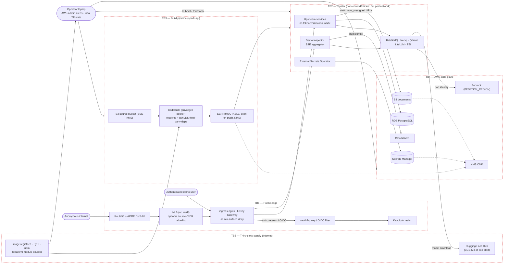

# STRIDE Threat Model — SPARK on AWS demo deployments

Scope: the **demo deployment layer in this repository** — Terraform modules,
Helm charts and values, the image build pipeline, the auth perimeter, the
demo inspector, and the operator workflow. The upstream applications
(`spark-workflow/`, `spark-api/` submodules) are **third-party code and out
of scope as products**; in scope is how this repo *integrates, builds,
configures and exposes* them, and the trust we place in them.

Environment classification: **demo**. Non-production, synthetic
data only, single AWS account, short-lived. Several findings below are
accepted risks for that classification and are marked as such — each with
the concrete change required before any production use.

Method: assets (with a confidentiality/integrity/availability rating) and
trust boundaries first, then STRIDE per element with evidence (file
references), current controls, and gaps. Every row carries an ID
(`<section>-<n>`) so findings, accepted risks and the checklist can point at
it. Ratings are qualitative (likelihood × impact) **for the demo posture**;
the "production delta" column states how the rating changes if the same
configuration were used with real data.

---

## 1. Assets

C/I/A = how much confidentiality, integrity and availability of the asset
matter **for the demo**; H/M/L.

| # | Asset | C | I | A | Why it matters |
|---|---|---|---|---|---|
| A1 | AWS account and its IAM identities | H | H | M | Full blast radius: compute, data, billing |
| A2 | Terraform state (local file) | H | H | L | Contains generated secrets in plaintext |
| A3 | Generated credentials in Secrets Manager (DB, RabbitMQ, Neo4j, LiteLLM master key, bizlog signing key, Keycloak admin/client/demo user, oauth2-proxy cookie secret, S3 access keys) | H | H | M | Direct path to data and to the LLM budget |
| A4 | RDS PostgreSQL data (all service databases, Keycloak realm, LiteLLM request log, decision log store) | M | H | M | Application state, identity state, the signed audit trail; synthetic content, real credentials hashes |
| A5 | S3 buckets (documents, quarantine, Temporal payloads, build source) | M | H | M | Document content (synthetic), build inputs (integrity of what gets built) |
| A6 | ECR images | L | H | M | What runs in the cluster — supply chain root |
| A7 | Amazon Bedrock invocation capability | M | L | M | Cost abuse, prompt/response exposure |
| A8 | Kubernetes control plane + node compute | M | H | M | Lateral movement, crypto-mining |
| A9 | Route53 hosted zone records | L | H | M | Traffic hijack, certificate issuance |
| A10 | Customer-managed KMS key (one per environment) | H | H | M | Encrypts A3, A5, ECR, RDS insights/logs, Valkey; key deletion or policy drift breaks every consumer |
| A11 | Demo integrity itself (a working, credible showcase) | — | H | H | The actual product of this repo |

## 2. Actors

| Actor | Trust | Notes |
|---|---|---|
| Presenter/operator | trusted | Holds AWS admin credentials, runs `make apply` |
| Authenticated demo user | semi-trusted | Passes Keycloak login; inside the perimeter has full app + inspector access |
| Anonymous internet | untrusted | Reaches the NLB, the ingress and the Keycloak login page (unless `DEMO_ALLOWED_CIDRS` is set) |
| Upstream code (submodules) | **untrusted-but-executed** | Runs in-cluster and in CI (dependency build) |
| Third-party registries/indexes (PyPI, npm, ghcr, quay, docker.io, public.ecr.aws, Hugging Face Hub, Helm repos, Terraform registry/GitHub) | untrusted | Supply chain for images, dependencies, models and infrastructure modules |
| AWS services | trusted platform | Shared-responsibility boundary |

## 3. Trust boundaries and data flow

Boundary summary:

- **TB1** anonymous → authenticated. Single enforcement point per demo:
  ingress-nginx `auth-url` → oauth2-proxy → Keycloak (spark-api), Envoy
  Gateway SecurityPolicy → Keycloak (spark-workflow). An optional L4
  source-CIDR allowlist sits in front of both and also fences the EKS API
  endpoint.
- **TB2** inside the cluster everything is mutually reachable and mutually
  trusted (no NetworkPolicies, node SG allows all node-to-node traffic,
  services do not verify tokens).
- **TB3** third-party code is *executed* during builds and the result is
  what runs in TB2.
- **TB4** AWS-managed data plane, reached with pod identities (least
  privilege attempted) and one static IAM user for S3; at-rest encryption
  under one customer-managed key.
- **TB5** everything fetched from the internet at build, apply or pod start:
  base images, Python/npm dependencies, Terraform modules, the embedding
  model. Pinned where this repo controls the reference.

---

## 4. STRIDE by element

### 4.1 Public edge (Route53, NLB, ingress, oauth2-proxy / OIDC filter, Keycloak)

| ID | STRIDE | Threat | Current controls (evidence) | Gap / finding | Risk (demo) | Production delta |
|---|---|---|---|---|---|---|
| E-1 | **S** Spoofing | Unauthenticated access to app, APIs, inspector | `auth-url`/`auth-signin` on **both** umbrella ingresses (spark-api), one SecurityPolicy per host (spark-workflow); `/oauth2` is the only unauthenticated path; scripted-login verified | Perimeter is a **single point of failure**: one ingress/route added without the annotations silently exposes everything. No automated check that every route carries them | Med | High — add admission policy/CI check enforcing the annotations |
| E-2 | **S** | **Perimeter switched off with an open load balancer** (`auth_enabled=false`, spark-api) | `terraform_data.perimeter_guard` precondition in `spark-api-demo/terraform/envs/demo/main.tf` refuses `auth_enabled=false` unless `allowed_cidrs` is non-empty | The guard couples the two knobs; it does not stop an operator from setting a too-wide CIDR. spark-workflow has no `auth_enabled` switch (OIDC is part of the gateway config) | Low | Med — remove the switch entirely outside demo environments |
| E-3 | **S** | Credential guessing on the login | Generated 16-char demo password in Secrets Manager | **No brute-force protection configured** in the realm (`bruteForceProtected` not set), no MFA, no account lockout | Med | High — enable brute-force detection + MFA, remove shared demo account |
| E-4 | **S** | Anyone in the realm passes | `OAUTH2_PROXY_EMAIL_DOMAINS="*"` — any realm user is accepted | Acceptable while the realm holds exactly one seeded user; **breaks the moment self-registration or an IdP federation is enabled** | Low | Med — restrict to explicit groups/domains |
| E-5 | **T** Tampering | Response body rewritten at the edge | `sub_filter` injects one script tag into the served HTML | The controller runs with `allowSnippetAnnotations=true` and `annotations-risk-level=Critical` (`terraform/modules/k8s-addons/main.tf`): **any** Ingress in the cluster may then inject nginx config. Combined with a compromised workload namespace this is an edge-takeover primitive | Med | High — replace injection with a dedicated static path + separate controller class, or bake the script; drop snippet permissions |
| E-6 | **T** | DNS/record hijack | external-dns with `txtOwnerId` ownership TXT records | `policy = "sync"` grants **delete** authority over records it considers owned; if the hosted zone is shared with anything else, a bug or a hostile record annotation can remove entries | Med | High — dedicated zone per demo, or `policy=upsert-only` |
| E-7 | **R** Repudiation | Who did what at the edge | ingress access logs, Keycloak events, CloudTrail (account default) | Logs are ephemeral (no retention/ship), Keycloak event storage not configured, no correlation ID across edge → service | Med | High — central logging + retention |
| E-8 | **I** Information disclosure | Session theft | TLS via ACME, `COOKIE_SECURE=true`, per-request CSRF cookies | Session lifetimes are long by demo design (access token 8 h, SSO 24 h — `keycloak-bootstrap-job.yaml`); no `SameSite`/`HttpOnly` hardening review documented; no HSTS/security headers set at the ingress | Med | High — short tokens, refresh rotation, HSTS+CSP+frame-ancestors |
| E-9 | **D** DoS | Public NLB, no rate limiting | Kubernetes-level resource limits; optional L4 allowlist | **No WAF, no rate limiting, no request-size limits beyond `proxy-body-size`**; login page and LLM-backed endpoints are reachable pre-auth/post-auth without throttling → cost amplification into Bedrock | Med | High — WAF + rate limits + per-user quotas |
| E-10 | **E** Elevation | Perimeter bypass reaches unauthenticated services | Services only reachable via ingress; no NodePorts | Any pod in the cluster (or anything that reaches the pod network) talks to every service **without authentication** — the perimeter is the *only* control (see 4.2) | High | Critical — service-to-service authN/Z |
| E-11 | **E** | **Keycloak admin console exposed on the public auth host** | `/admin/master/**` and `/realms/master/**` return 403 from the internet — nginx `server-snippet` (spark-api `auth-ingress.yaml`), `HTTPRouteFilter` `directResponse` on a dedicated route (spark-workflow `httproutes.yaml`). Verified live in both demos | Without the deny, the `master` realm's admin console and login are internet-reachable with only the generated bootstrap admin password in front. Residual: the token-protected admin REST API `/admin/realms/<realm>` stays reachable **by design** (identity-management-service calls it through the public hostname via `AUTH_BASE_URL`) — a blanket `/admin` deny breaks user management, so this path relies on token validation alone | Low | High — admin surface on a separate internal-only host (`KC_HOSTNAME_ADMIN`), admin REST via in-cluster service only, MFA on admin accounts |
| E-12 | **S** | **Admin-surface deny bypassed by path encoding** (spark-api) | The nginx deny matches the normalized `$uri` (percent-decoded, `//` merged, dot segments resolved) instead of the raw `$request_uri`; `scripts/verify.sh` probes `/%61dmin/master`, `//admin/master`, `/admin//master`, `/realms/local/../master/` with `--path-as-is` and expects 403, and 401 for `/admin/realms/local/users` | A deny that matched the raw request line would let an encoded or double-slash spelling reach Keycloak. Envoy Gateway (spark-workflow) matches on the normalized path by default (`PathPrefix` after normalization); its probe set is the manual check in DEMO.md | Low | Med — add the probe set to a CI smoke test for both demos |
| E-13 | **S/I** | **Whole demo reachable by anonymous internet on a company or personal account** | Optional L4 allowlist: `DEMO_ALLOWED_CIDRS` → `loadBalancerSourceRanges` on the NLB (ingress-nginx Service / EnvoyProxy `envoyService`), covering every hostname and both `:80`/`:443`; the same list fences the EKS public API endpoint (`cluster_endpoint_public_access_cidrs`). Optional corporate identity provider (`EXTERNAL_OIDC_*`, any OIDC issuer): spark-api's oauth2-proxy authenticates against it and the Keycloak host is fenced behind the same check; spark-workflow's realm brokers to it with the Identity Provider Redirector as default, so an anonymous visitor gets nothing but a redirect to the issuer on every page | A security scan flags **any** unauthenticated response, and an OIDC login redirect counts as one — route-level OIDC does not clear the finding by itself. Both controls default to **off/empty (open)** so a from-zero bring-up and a customer's test keep working, i.e. they are opt-in and easy to forget. With the identity provider set, the redirect to the issuer and spark-workflow's token-protected realm admin REST API (E-11) are the only anonymous responses left. No WAF either way | Med (open) / Low (set) | High — private/internal LB plus a corporate-auth proxy in front, or no internet exposure at all |
| E-14 | **S/E** | **EKS API endpoint public without CIDR restriction** | `public_access_cidrs = local.allowed_cidrs` in both `modules/eks`; `authentication_mode = "API"` with cluster-creator admin only | Empty allowlist keeps the endpoint open (IAM-authenticated, but reachable). The operator must include their own address or the apply locks itself out — documented in `.env.example` | Low (set) / Med (open) | High — private endpoint + bastion/VPN |

### 4.2 In-cluster runtime (upstream services, platform components, inspector)

| ID | STRIDE | Threat | Current controls | Gap / finding | Risk (demo) | Production delta |
|---|---|---|---|---|---|---|
| R-1 | **S** | Service impersonation / unauthenticated internal calls | Cluster-internal DNS only. **spark-workflow 0.3.0:** the backend pools run `AUTH_MODE=strict` — every user request carries the Bearer token Envoy forwards after the perimeter login and SpiceDB permissions are enforced; a calling *service* is identified by the SPIFFE id in `x-forwarded-client-cert` (`AUTH_ALLOWED_MACHINE_IDENTITIES`) | **spark-api:** upstream services perform **no token verification** (`APP_ENV=dev`, permissive CORS regexes, one service accepts *any* bearer token); frontend ships a literal placeholder token; everything inside TB2 is implicitly trusted. **spark-workflow:** the SPIFFE header is designed to be set by an Istio sidecar from the caller's mTLS certificate; the demo runs no mesh, the agent modules carry no credential, so the `machine-identity-proxy` (nginx, app namespace) stamps a self-asserted `spiffe://cluster.local/ns/<ns>/sa/agent-modules` on the modules' calls into the pools — any pod in the cluster could send the same header directly, so the pools' trust in machine callers is the cluster network, as it was before | High | Critical — mTLS/service mesh (Istio STRICT, then the header is unforgeable and the proxy goes) or per-service JWT validation |
| R-2 | **T** | Lateral tampering between components | Namespaces `…-platform` / app split | **No NetworkPolicies at all**; node SG permits all node-to-node traffic (deliberate, documented, required by upstream port usage). A single compromised pod reaches RabbitMQ, Neo4j, Qdrant, LiteLLM, RDS and the inspector. spark-workflow 0.3.0 ships default-deny NetworkPolicies in its `environment-config` chart; the demo sets `networkPolicy.enabled=false` because their egress allowlist (53, 443, 5432 into `10.0.0.0/8`) does not cover Keycloak/LiteLLM/SpiceDB in the platform namespace, ElastiCache on 6379 or the Bedrock endpoint | High | Critical — default-deny NetworkPolicies per namespace (for spark-workflow: enable the upstream policies with `extraEgress` for the platform namespace, Valkey and Bedrock) |
| R-3 | **T** | Message-broker abuse | RabbitMQ user is generated, cluster-internal only | Broker accepts the demo user from anywhere in the pod network; scaffolding queue/exchange are world-writable inside the cluster; no vhost separation per service | Med | High — per-service vhosts/users |
| R-4 | **T** | **Embedding model swapped under the demo at pod start** | TEI pulls `BAAI/bge-m3` from the Hugging Face Hub at pod start with `--revision=<commit>` (`helm/platform/values.yaml` `tei.revision` in both demos) | The download itself is still a runtime dependency on an external registry (availability; see R-5). No checksum verification beyond the Hub's commit addressing; no offline copy | Low | Med — bake the model into an image or mirror it to S3 with a checksum |
| R-5 | **D** | **Runtime model download fails** (Hub outage, rate limit, revision removed) | emptyDir cache, readiness probe with 40 retries | TEI stays unready and every embedding-backed feature (search, RAG) fails until the download succeeds; nothing in the demo pre-warms the model | Med | High — pre-baked image or S3 mirror, PVC cache |
| R-6 | **R** | Business-event integrity | bizlog audit signing key generated and injected (`BIZLOG_AUDIT_SIGNING_KEY`); since spark-api v0.5.1 the signed audit/decision events are published to RabbitMQ (durable `bizlog_exchange`) and persisted append-only by `decision-log-store-service` in its own RDS database after HMAC verification (same key as `HMAC_SIGNING_KEY`); ordinary business events stay on stdout | The store is single-instance and shares the application DB role (D-2); its REST API (`/v1/decision-steps`) is reachable from the cluster without authentication like every other service (E-10, R-1); a publisher whose broker publish fails falls back to local logs, so the trail can have gaps under broker outages; stdout business events keep pod-lifetime retention | Low | Med — dedicated DB role, retention/backup policy for the store, alert on dead-lettered audit messages |
| R-7 | **I** | Secrets readable in the cluster | ESO syncs only the enumerated ARNs; `external_secrets_create_permission=false`; pod identity per addon; ESO's `kms:Decrypt` is limited to the environment's key (`external_secrets_kms_key_arns`) — the module default is every key in the account | Kubernetes Secrets are readable by anything with RBAC in the namespace; **no EKS envelope encryption for secrets configured** (`encryption_config` absent) — etcd-level protection relies on the AWS-managed default only | Med | High — KMS envelope encryption + tight RBAC + short-lived DB creds |
| R-8 | **I** | Inspector widens the blast radius | Read-only sources; behind the perimeter; runs as uid 65534; the overlay builds its panel from DOM nodes/`textContent` — request paths, model/queue names and backend error text never become markup (`inspector.js`); the backend maps a failing source to one of nine constant error categories and logs the exception server-side only (`_public_error` in `main.py`), so no exception text, internal URL or caller ARN reaches the browser; base image digest-pinned with a `HEALTHCHECK` | The inspector pod holds the **LiteLLM master key** and **RabbitMQ credentials** in env, and its SSE endpoint has **no authentication of its own** (`inspector/app/main.py`) — it is protected solely by the ingress annotation. It also exposes model names, token counts and queue activity to every authenticated user | Med | High — separate read-only credentials, own authZ, disable in production |
| R-9 | **I** | Prompt/response exposure | LiteLLM in-cluster, Bedrock over AWS network | The LiteLLM **request log persists prompts/metadata** in RDS to feed the inspector; no redaction, no retention policy | Med | High — disable or redact the request log, set retention |
| R-10 | **D** | Resource exhaustion | Requests/limits on our components; dedicated tainted pool for stateful workloads | Upstream workloads dominate the cluster; a runaway component can starve the node pool; no PodDisruptionBudgets/quotas per namespace | Low | Med — ResourceQuotas + PDBs |
| R-11 | **E** | Container → node → cloud | Pod identities are per-workload and scoped (`bedrock:InvokeModel*` on foundation models; ESO on listed secret ARNs + one KMS key) | Our charts set **no securityContext** (no `runAsNonRoot`, no `readOnlyRootFilesystem`, no dropped capabilities); the frontend deliberately runs as root; no Pod Security Standards enforced on the namespaces. A container escape inherits node role + instance metadata | Med | High — PSS `restricted`, explicit securityContexts, IMDSv2 hop limit review |
| R-12 | **E** | Inspector IAM over-scope | Only two read actions | `cloudwatch:GetMetricData/ListMetrics` on `Resource = "*"` — reads **all** account metrics, not just Bedrock (`terraform/modules/k8s-addons/iam.tf`) | Low | Med — condition on namespace/metric or drop |

### 4.3 Build pipeline and infrastructure supply chain (source bucket → CodeBuild → ECR; Terraform modules; upstream images)

This is the highest-value target: it produces what runs in TB2.

| ID | STRIDE | Threat | Current controls | Gap / finding | Risk (demo) | Production delta |
|---|---|---|---|---|---|---|
| B-1 | **S** | Unauthorized build trigger | Only IAM principals with `codebuild:StartBuildBatch` can trigger; source comes from a private, versioned, SSE-KMS bucket | Whoever can write the source object **or** start a batch controls image content; there is no approval gate or provenance record | Med | High — protected source, signed provenance, restricted trigger role |
| B-2 | **T** | Dependency substitution during build | Pinned `uv` version; vendored path deps; dev group stripped; base-image map centralised | The build **resolves and builds third-party dependencies from public indexes** (`uv lock`, `npm ci`): build backends and npm lifecycle scripts of *any* transitive dependency execute inside a **privileged** CodeBuild container that holds ECR push credentials (`privileged_mode = true`, required for `docker build`; the role pushes only to its own repositories and reads only its own bucket). Classic CI code-execution → image-poisoning path | **High** | Critical — hash-pinned lockfiles committed, private mirror/CodeArtifact, non-privileged builds (buildkit rootless), egress allowlist |
| B-3 | **T** | Base-image tag movement | Images pinned by tag in one map (`pipeline/base-image-map.env`); the map rewrites the upstream placeholders **and** the bare Docker Hub references the v0.5.1 Dockerfiles carry (frontend, request-proxy, ki-guv-feedback) to public.ecr.aws/ghcr.io; the inspector's own base image and the dokumentenschwaerzung `uv:0.9.30` builder are digest-pinned | Upstream-derived images still use tags, not digests: `python:3.12-bookworm`, `python:3.12-slim-bookworm`, `node:20-bookworm`, `nginx-unprivileged:1.29-alpine`, `uv:python3.12-bookworm(-slim)`; platform images `keycloak:26.0`, `oauth2-proxy:v7.8.1`, `litellm:main-stable` (a **moving** tag) | Med | High — digest pinning + renovate-style updates |
| B-4 | **T** | **Upstream (spark-workflow) images referenced by mutable tags** | The upstream charts reference the openCode registry images by version tag; the overlay pins `v0.3.0` for every image the demo runs (one `spark-backend` image for the 15 pools, frontend, nine modules, three data services, llm-client, rechtsaenderungs-monitoring; spark-workflow README section E) | A re-pushed tag would be pulled on the next node start (`imagePullPolicy: IfNotPresent`, no digest, no signature verification). The 0.2.3 security fixes (PII redaction leak in `modul-anonymisierung`, upstream issue #40; prompt-schema drift in `modul-formale-pruefung`) are **in** the v0.3.0 module images the demo runs since the 0.3.0 re-integration | Med | High — mirror to ECR with digest pins and admission verification |
| B-5 | **T** | Image mutation after push | ECR repositories `IMMUTABLE`, content-addressed tags (`<sha>-p<hash>`), no `:latest` pushed; buildspecs skip an existing tag instead of re-pushing; Makefile refuses to deploy without a resolvable tag | `force_delete = true` remains for the hands-off destroy; no signing (cosign) or admission verification | Low | High — signing + verification admission, no `force_delete` |
| B-6 | **T** | **Terraform modules resolved from version ranges** | `terraform-aws-modules/{vpc,eks,eks-pod-identity}` pinned to the commit of their release tag (`git::…?ref=<sha>`) | The pinned modules' own nested modules (e.g. `terraform-aws-modules/kms` inside eks) still resolve by range from the registry — that is the upstream module's choice. Providers are hash-locked by the committed `.terraform.lock.hcl` of each root (darwin/linux hashes recorded by `terraform init`) | Low | Med — commit the provider lock file, vendor or mirror modules |
| B-7 | **T** | Upstream submodule swap | Submodule pinned to a commit; `push-source.sh` refuses a dirty submodule | No signature/provenance verification of the upstream repo; a compromised upstream commit that the operator pulls is built and deployed | Med | High — pinned + reviewed bumps, provenance attestation |
| B-8 | **I** | Secret leakage into build logs | No secrets are passed to builds (vendor strategy removed the private-index secrets); logs scoped to one log group, retention 365 days, KMS-encrypted | Build logs are verbose (full dependency resolution) and readable by anyone with CloudWatch read in the account | Low | Med — log scrubbing, least-privilege log readers |
| B-9 | **R** | No build provenance | Tags encode source SHA + pipeline hash; batch history in CodeBuild; immutable tags make the tag → content binding permanent | No attestation linking image digest → source commit → builder identity | Med | High — SLSA provenance |
| B-10 | **D** | Build resource abuse | Batch size bounded by the service list; XLARGE only for the frontend | An attacker who can trigger builds can burn compute; no concurrency cap | Low | Med — concurrency limit + budget alarm |
| B-11 | **E** | Missing vulnerability visibility | `scan_on_push = true` on every ECR repository | Scan results are not gated on: a critical finding does not stop the deploy. Basic scanning only (no enhanced/continuous scanning) | Low | High — enhanced scanning, gate on findings |

### 4.4 AWS data plane (KMS, RDS, S3, Secrets Manager, Bedrock, ElastiCache)

| ID | STRIDE | Threat | Current controls | Gap / finding | Risk (demo) | Production delta |
|---|---|---|---|---|---|---|
| D-1 | **S** | Stolen static S3 keys | Dedicated IAM user, actions limited to object CRUD on the demo buckets and `kms:GenerateDataKey*`/`Decrypt` on the environment key only | **Static long-lived access keys** exist because upstream expects endpoint+keys; they live in Secrets Manager, are synced into the cluster, and never rotate | Med | High — IRSA/pod identity for object access or a signing service; no static keys |
| D-2 | **T** | Unauthorized DB writes | Private subnets, SG-scoped to nodes, `publicly_accessible=false`, encrypted at rest; IAM database authentication enabled (additive), engine logs exported, Performance Insights + Enhanced Monitoring | **One shared application role** for all service databases (including Keycloak's) — no per-service isolation; `rds.force_ssl` defaults to **off** because upstream DSNs omit `sslmode`, so in-VPC traffic can be plaintext | Med | High — per-service users + `force_ssl=1` + TLS-verified DSNs |
| D-3 | **T** | Destructive teardown | Intentional for a demo: `force_destroy` buckets, `force_delete` ECR, `skip_final_snapshot`, secrets `recovery_window=0`, KMS key 7-day deletion window; `deletion_protection` is a variable (default false), S3 versioning keeps overwritten/deleted objects for 7 days | The same code applied against anything real deletes data irrecoverably with a single command | Low (demo) | **Critical** — flip all of these before any non-demo use |
| D-4 | **I** | **Prompts and document content cross a region boundary** | `BEDROCK_REGION` defaults to `eu-central-1` in both demos; the EU cross-region profiles (`eu.` prefix) keep routing inside the EU geography | The variable still allows any region; nothing checks that `bedrock_region` and `aws_region` share a geography. Bedrock model invocation logging is not configured, so the crossing leaves no trace on our side | Low (default) / Med (changed) | High — validation rule tying the geographies, Bedrock invocation logging, data-residency decision recorded |
| D-5 | **I** | Browser-facing bucket CORS | CORS limited to the demo frontend origin, methods GET/PUT/POST/HEAD, Block Public Access on | `allowed_headers = ["*"]`; presigned URLs are generated by upstream services with the shared credentials — URL leakage equals object access for the URL's lifetime | Low | Med — narrow headers, short expiry, per-object scoping |
| D-6 | **I** | Secret sprawl | All credentials generated by Terraform, never in git; `.env` untracked and gitignored; every Secrets Manager entry encrypted with the environment's CMK | **Terraform state is a local file** containing every generated password in plaintext (`terraform.tfstate` next to the code, gitignored but unencrypted on the laptop and in any backup) | **High** | Critical — encrypted remote backend (S3+KMS, DynamoDB lock), state access audit |
| D-7 | **I** | At-rest encryption with shared AWS-managed keys | One customer-managed key per environment (`terraform/modules/kms`, rotation on) for Secrets Manager, S3 (SSE-KMS + Bucket Keys), ECR, CodeBuild + its log group, RDS Performance Insights + exported logs, ElastiCache | Key policy delegates to IAM (`root` statement) — anyone with `kms:*` in the account can use the key. RDS storage and EBS volumes still use the AWS-managed default keys (changing them re-creates the instance/volumes) | Low | Med — grants per principal, CMK for RDS storage/EBS from the first apply |
| D-8 | **A** | **KMS key deleted or policy broken** | 7-day deletion window (minimum); key created before every consumer in the dependency graph | A scheduled deletion silently breaks every secret read, S3 object read, image pull and log write after the window; no alarm on `ScheduleKeyDeletion` | Low | High — CloudTrail alarm, longer window, key policy deny on deletion |
| D-9 | **I** | Model input/output exposure | Bedrock reached over the AWS network with pod identity, no keys | Prompt content is not logged by us **except** via the LiteLLM request log (see R-9); Bedrock model invocation logging is not configured either way | Low | Med — explicit decision + retention for model I/O |
| D-10 | **D** | Bedrock cost abuse | IAM scoped to invoke on foundation models; single-tenant demo | No per-user or per-service quota, no budget alarm; an authenticated user can drive LLM calls through the app | Med | High — quotas, budgets, alerting |
| D-11 | **E** | Broad admin credentials | Least-privilege pod identities for workloads | The **operator uses an account-admin profile** for apply/destroy; no separate plan/apply roles, no MFA-gated break-glass separation documented | Med | High — split roles, least-privilege CI role, MFA |

### 4.5 Operator workflow and repository

| ID | STRIDE | Threat | Current controls | Gap / finding | Risk (demo) | Production delta |
|---|---|---|---|---|---|---|
| O-1 | **T** | Malicious/broken change lands | Everything is IaC and reviewable; submodules read-only by rule; `terraform validate` + `helm lint` before apply; documented deviations; checkov + semgrep at zero findings with reasoned inline suppressions | No CI on this repo (no automated plan/lint/policy/scan on change), no branch protection, no signed commits | Med | High — CI gates, policy-as-code, protected branches |
| O-2 | **I** | Secrets in git | `.gitignore` covers state and `.env`; verified sweeps for account IDs/domains; secrets only in Secrets Manager | No automated secret scanning in the workflow (manual greps and the checkov `secrets` framework only) | Low | Med — gitleaks/pre-commit hook |
| O-3 | **S** | Credential theft from the laptop | Short-lived AWS session credentials, kubeconfig via `update-kubeconfig` | Local state + kubeconfig + admin session on one workstation is the single strongest credential set in the system | Med | High — dedicated bastion/CI, no local state |
| O-4 | **R** | Change attribution | Conventional Commits, every deviation documented with the observed cause | No signed commits/tags; CloudTrail is the only apply record | Low | Med — signed commits, CI-only applies |

---

## 5. Prioritised findings (demo posture)

Ranked by exploitability × impact **as deployed**:

1. **CI executes third-party build code with privileged Docker + ECR push
   rights** (B-2). Poisoned dependency ⇒ poisoned image ⇒ cluster
   compromise. *Mitigate first if this pattern is reused anywhere real.*
2. **Local Terraform state holds all generated secrets in plaintext** (D-6).
3. **Flat, unauthenticated cluster interior** — perimeter is the only
   control (E-10, R-1, R-2).
4. **Edge injection requires cluster-wide critical snippet permissions**
   (E-5).
5. **Tag-pinned base and upstream images; no signing or admission
   verification** (B-3, B-4, B-5).
6. **No brute-force protection / MFA on the login, long sessions**
   (E-3, E-8).
7. **Static, non-rotating S3 keys and a single shared DB role** (D-1, D-2).
8. **Inspector holds high-value credentials and has no own authZ** (R-8).
9. **No WAF/rate limiting in front of LLM-backed paths** (E-9, D-10).
10. **No central logging → weak forensics** (E-7, R-6).
11. **Runtime model download as an availability dependency** (R-5).

## 6. Accepted risks (explicit, demo-only)

These are deliberate and documented in each project's README deviations;
the static-analysis suppressions in the code point back at them:

- Perimeter-only authentication; upstream services trust the network
  (E-10, R-1, R-2).
- `APP_ENV=dev` and permissive CORS inside the demo host (R-1).
- `rds.force_ssl=0`, one shared application DB role (D-2).
- Static S3 credentials (upstream expects endpoint+keys) — checkov
  `CKV_AWS_273`/`CKV_AWS_40` suppressed (D-1).
- No Secrets Manager rotation — the services receive the values once via
  ESO as static environment variables; `CKV2_AWS_57` suppressed (D-1, D-6).
- Single-AZ RDS and single-node Valkey — `CKV_AWS_157`, `CKV2_AWS_50`
  suppressed; `multi_az` stays a variable (availability only).
- Destructive teardown flags (`force_destroy`, `force_delete`,
  `skip_final_snapshot`, `recovery_window=0`, `deletion_protection=false`
  by default, 7-day KMS deletion window) so `make destroy` really removes
  everything — `CKV_AWS_293` suppressed (D-3).
- No S3 server access logging, replication or event notifications on
  demo buckets — `CKV_AWS_18`, `CKV_AWS_144`, `CKV2_AWS_62` suppressed.
- Privileged CodeBuild for `docker build` — `CKV_AWS_316` suppressed (B-2).
- Frontend container runs as root (image templates config at startup)
  (R-11).
- Public EKS API endpoint when `DEMO_ALLOWED_CIDRS` is unset (E-14).
- Demo inspector exposes internal activity to authenticated users (R-8).
- Internet-reachable hostnames with `DEMO_ALLOWED_CIDRS` unset and no
  corporate identity provider (`EXTERNAL_OIDC_*`) configured. On a company
  or personal AWS account this is **not** acceptable — set the allowlist or
  the identity provider, or tear the demo down after use (E-13).
- Keycloak's admin REST API (`/admin/realms/<realm>`) answers on the public
  auth host, protected by bearer-token validation only, because
  identity-management-service calls it through that hostname (E-11).
- Embedding model fetched from the Hugging Face Hub at pod start (pinned
  revision, no offline copy) (R-4, R-5).

Each item is safe **only** because: single-tenant demo account, synthetic
data, no real users, short lifetime, and the environment is torn down.

## 7. Hardening checklist for production use

Ordered so that each step removes a top finding:

1. Builds (B-2, B-3, B-4, B-9): commit hash-pinned lockfiles, resolve from
   a private mirror, drop `privileged_mode`, digest-pin base and upstream
   images, sign images and verify at admission, gate on scan findings.
2. State (D-6): encrypted remote backend with locking and restricted
   access; rotate every credential generated while state was local.
3. Network (E-10, R-1, R-2, D-2): default-deny NetworkPolicies per
   namespace, per-service RabbitMQ vhosts, per-service DB users,
   `force_ssl=1` with verified TLS.
4. Identity (E-3, E-4, E-8): real users in Keycloak (no shared account),
   MFA, brute-force protection, short access tokens with refresh rotation,
   group-scoped `EMAIL_DOMAINS`, service-to-service authN (mesh mTLS or
   JWT).
5. Edge (E-5, E-6, E-9, E-11, E-13, E-14): WAF + rate limiting, security
   headers (HSTS/CSP), remove cluster-wide snippet permissions, dedicated
   DNS zone with `upsert-only`, admin surface on an internal-only host,
   private EKS endpoint, no internet exposure or a corporate-auth proxy.
6. Data (D-1, D-3, D-4, D-7, D-8): private S3 access without static keys,
   short presigned lifetimes, deletion protection + final snapshots +
   secret recovery windows on, CMK grants per principal and CMK for RDS
   storage/EBS, geography validation for `bedrock_region`, alarm on key
   deletion.
7. Observability (E-7, R-6, D-9, D-10): central log shipping with
   retention, Keycloak event store, correlation IDs, Bedrock invocation
   logging, budget alarms and quotas, CloudTrail alerting on IAM/secret/KMS
   access.
8. Workload posture (R-10, R-11): Pod Security Standards `restricted`,
   explicit securityContexts, ResourceQuotas, PDBs, EKS secrets envelope
   encryption with a customer-managed key.
9. Pipeline governance (O-1 to O-4, B-6): CI on this repo (validate / lint
   / policy / secret scan / checkov / semgrep), lock-file verification
   (`terraform providers lock` for every target platform), protected
   branches, signed commits, least-privilege apply role, no interactive
   admin applies.
10. Disable demo-only components in production values (R-8, R-9): inspector
    off, LiteLLM request log off or redacted, seed jobs off; bake or mirror
    the embedding model (R-4, R-5).

## 8. Maintenance

Re-run this model when any of the following changes: the auth perimeter,
the injection mechanism, the build pipeline, IAM or KMS policies, exposed
hostnames, the Bedrock region, pinned module/model/image references, or the
set of components in the platform chart. Keep the evidence references
current — every claim above is anchored in a file in this repository, not
in intent.
