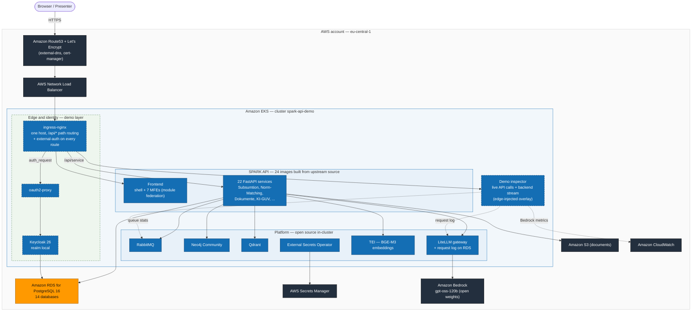
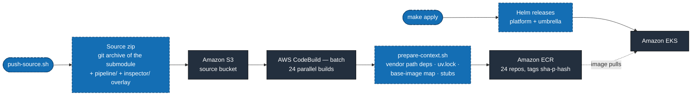

# SPARK API on AWS EKS — Demo Deployment

Fully automated demo deployment of [SPARK API](https://gitlab.opencode.de/bmds/planungs-und-genehmigungsbeschleunigung/spark-api) (BMDS / planning and approval acceleration, EUPL-1.2) on Amazon EKS — open-source core, AWS managed services as the infrastructure foundation.

> **This is sample code, for non-production usage.** You should work with
> your security and legal teams to meet your organizational security,
> regulatory and compliance requirements before deployment. The
> [threat model](../docs/THREAT-MODEL.md) lists the demo-only risks this
> deployment accepts and the hardening required before any production use.

> Status: **Live.** All 22 in-scope backend services + the frontend build from
> source and run green; `scripts/verify.sh` passes end to end.
> Presenter runbook: [DEMO.md](DEMO.md).

## TL;DR — executive summary

**SPARK API** is the API-first sibling of SPARK Workflow: 22 FastAPI
services plus a microfrontend portal — and upstream publishes **no
container images**. This demo therefore proves the harder story: AWS
builds all 24 images from the unmodified public source (CodeBuild batch
into ECR), deploys them onto EKS with an explicit wiring matrix, and adds
what the upstream scope leaves open — an open-source OIDC login perimeter
(Keycloak + oauth2-proxy) and a **demo inspector** that shows live which
API calls the UI makes and what happens behind them (every LLM call to
Amazon Bedrock with tokens and latency, queue activity, CloudWatch
counters). One `make bootstrap` from an empty account to a green
`verify.sh`; one `make destroy` back to zero — both verified hands-off.

## Why this demo is built this way

1. **The product is an API — make that visible.** The inspector exists
   because the UI is just one client: every click is shown as the REST
   call it really is, and the backend tab shows the moment AWS services
   (Bedrock) do the heavy lifting. Demo philosophy: full transparency of
   the machinery, injected at the edge without touching upstream code.
2. **Sovereignty rule as in the workflow demo**: application components
   stay open source and in-cluster (RabbitMQ, Neo4j, Qdrant, Keycloak,
   LiteLLM, TEI — no Cognito, no Neptune, no Amazon MQ drop-in); AWS
   provides the commodity substrate (EKS, RDS, S3, Secrets Manager,
   ECR/CodeBuild, Bedrock behind LiteLLM's upstream model names).
3. **Build-from-source instead of waiting for a registry**: no published
   images is not a blocker — it becomes the demo's differentiator. A CI
   context assembler makes each service buildable from the pristine
   checkout; content-addressed tags make every rollout reproducible.
4. **Auth is deliberately OUR layer**: upstream delegates login to its
   platform (outside demo scope), so the demo enforces an OSS perimeter in
   front of the whole host — again without patching a single upstream file.

## Architecture

Legend: 🟦 **blue** = open source in-cluster (solid border = built from the
upstream sub-project, dashed = added by this demo) · 🟧 **orange** =
open-source engine as AWS managed service · ⬛ **dark** = AWS-native
managed substrate. (Mermaid cannot load the official AWS architecture
icons portably, so the diagram follows the AWS color language instead.)



**Upstream vs. demo layer:** the blue solid boxes run upstream code (built
from the unmodified submodule); dashed boxes are this demo's additions
(auth perimeter, inspector, edge routing) — all of it Terraform/Helm in
this repo. The platform components are the OSS dependencies upstream
expects; the demo operates them in-cluster.

### The build pipeline (upstream publishes no images)



## What sets this apart from spark-workflow-demo

SPARK API does **not publish ready-made container images**. This demo project therefore builds all 23 service images plus the frontend monorepo image itself:

- **Amazon ECR** as the private registry
- **AWS CodeBuild** (batch build, 24 parallel builds) builds every image from the unmodified submodule source
- `pipeline/prepare-context.sh` transforms each service directory into a self-contained build context **in CI** (vendored path deps, generated `uv.lock`, base-image mapping, stubs for files upstream references but does not track) — the submodule itself is never touched ([ADR 0001](docs/adr/0001-image-build-strategy.md))
- Instead of the 27 upstream scaffold charts, one **generic demo umbrella chart** deploys all services from an explicit wiring matrix (see [Deviations](#deviations-from-the-upstream-defaults--what-where-why), section C)

## Quickstart

```bash
# 0) Configure once: copy .env.example to the repo root as .env and fill it in
make bootstrap                  # FROM ZERO: infra -> image builds (blocking) -> workloads
./scripts/verify.sh             # 6 checks: addons, platform, ESO, pods, edge
```

`make bootstrap` orders the three phases (a plain `apply` on an empty account
would roll workloads before any image exists). Day-2 loop:

```bash
./scripts/push-source.sh        # source changed? -> rebuild batch (md5-idempotent)
make apply                      # roll to the new tag / apply infra changes
make destroy                    # full teardown (fully automatic, no manual cleanup)
```

Verified end to end: `make destroy && make bootstrap` from an empty account
produces a green `verify.sh`.

Image tags are `<git-short-sha>-p<md5 of the pipeline files>`: a change to the build pipeline re-tags and rebuilds even when the submodule SHA is unchanged (`scripts/image-tag.sh`, exported by the Makefile as `TF_VAR_image_tag`).

## Component detail

| Component | Operation | Service |
|---|---|---|
| Frontend (shell + 7 MFEs, one nginx image) | EKS | Demo umbrella chart |
| 22 FastAPI services | EKS | Demo umbrella chart (generic template + wiring matrix) |
| Auth perimeter (Keycloak 26 + oauth2-proxy) | EKS | OSS OIDC in front of the whole host (see below) |
| Demo inspector (API visibility overlay) | EKS | MIT-0 demo tooling from this repo (see below) |
| PostgreSQL (12 service DBs) | **AWS Managed** | Amazon RDS for PostgreSQL 16 |
| Object storage | **AWS Managed** | Amazon S3 |
| RabbitMQ | EKS | StatefulSet (bizlog requires plain AMQP without TLS/creds → Amazon MQ is not a drop-in) |
| Vector database (Qdrant) | EKS | Upstream image, tainted single-AZ pool |
| Graph database (Neo4j Community) | EKS | No OSS-based managed service on AWS |
| LLM gateway (LiteLLM → Amazon Bedrock) + TEI embeddings | EKS | Serves the exact upstream model names |
| Ingress (ingress-nginx) | EKS | Behind AWS NLB; one host, `/api/<service>` path routing |
| DNS/TLS | **AWS Managed** | Route53 (external-dns) + Let's Encrypt (cert-manager) |
| Secrets | **AWS Managed** | AWS Secrets Manager + External Secrets Operator |
| Image build | **AWS Managed** | ECR + CodeBuild batch |
| demosplan platform (PHP, MySQL, Elasticsearch, Keycloak) | — | Outside demo scope v1 (spec decision) |

## Demo additions on top of upstream (deployment layer only)

Both additions live entirely in this repo's Terraform/Helm — the submodule
and the built upstream images stay byte-identical.

### Auth perimeter (Keycloak + oauth2-proxy)

SPARK API v0.4.x ships no authentication — upstream delegates it to the
demosplan platform (outside demo scope v1), which would leave the demo
fully public. The demo enforces an OSS OIDC perimeter at the edge:

- **Keycloak 26** in-cluster (RDS-persisted, bootstrap job seeds realm
  `local`, a confidential client and the demo user — pattern ported from
  spark-workflow-demo), public login host `auth-api.<domain>`
- **oauth2-proxy** in `auth_request` mode: ingress-nginx checks every
  request via the in-cluster `/oauth2/auth` endpoint and redirects browsers
  into the login flow on the same host; back-channel (redeem/JWKS/userinfo)
  stays in-cluster
- Everything on the API host is protected (frontend, `/api/*`, inspector);
  the SPA works unchanged because the session cookie is same-origin
- Perimeter model by design: the upstream services perform no token
  verification — inside the cluster they trust the network, exactly as
  upstream intends with its platform. Toggle: `SPARK_API_AUTH_ENABLED`
- Demo login: `aws secretsmanager get-secret-value --secret-id
  spark-api-demo/auth/keycloak` (keys `demo_user_email`/`demo_user_password`)

### Demo inspector — making the API visible

The product IS an API; the UI is just a client. The inspector makes that
demonstrable ([DEMO.md](DEMO.md) has the walkthrough):

- A floating **"API" button** in the UI opens a two-tab panel:
  **API Calls** (every request the SPA sends: method, service, path,
  status, duration — via fetch/XHR patch) and **Backend** (what happens
  behind the API: every LLM call from the LiteLLM request log with model,
  tokens and latency — the Amazon Bedrock moment —, RabbitMQ queue
  activity, CloudWatch `AWS/Bedrock` invocation counts)
- Injected **at the demo edge**: an ingress-nginx `sub_filter` adds one
  script tag to the served `index.html`; the upstream frontend image is
  untouched. Backend/overlay are MIT-0 code in [`inspector/`](inspector/),
  built by the same CodeBuild batch as the upstream images
- Read-only against every source, behind the OIDC perimeter, toggle
  `inspector.enabled`

### Network exposure controls

Two controls in this repo's layer, both driven by a security scan of the
live deploy (a company or personal AWS account may not serve anything to
unauthenticated callers, and the scanner counts an OIDC **login page** as
exactly that):

| Control | What it does | Where |
|---|---|---|
| Keycloak admin surface denied at the edge | `/admin/master/**` (the console for every realm) and `/realms/master/**` return 403 from the internet. Scope is deliberately *not* `/admin`: the token-protected admin REST API lives under `/admin/realms/<realm>` and services call it through the public hostname — a blanket deny breaks user management (observed in spark-workflow: `GET /users` 500). Admin access goes through `kubectl port-forward svc/keycloak 8080:80` | `helm/platform/templates/auth-ingress.yaml` (nginx `server-snippet`) |
| Source-IP allowlist on the public NLB | `DEMO_ALLOWED_CIDRS` in the root `.env` (comma-separated) becomes `loadBalancerSourceRanges` on the ingress-nginx Service, i.e. ingress rules on the NLB's security group. One value covers every hostname and both `:80`/`:443`. **Empty = open to the internet** (the from-zero default) | `.env` → `Makefile` → `terraform/modules/k8s-addons/main.tf` |

An nginx-level allowlist would not work here: with NLB `ip` targets and
`use-proxy-protocol=false`, nginx never sees the real client address — the
restriction has to sit at L4.

For an internal-account deployment, pick one: set `DEMO_ALLOWED_CIDRS` to
the ranges your audience comes from, or leave it open and run
`make destroy` after the demo (from-zero bring-up is reproducible via
`make bootstrap`).

## Deviations from the upstream defaults — what, where, why

The upstream code (submodule) is **unmodified**. All deviations live in this
repo: build pipeline (`pipeline/`), Terraform (`terraform/`), wiring matrix
(`helm/values/spark-api.demo.yaml.tftpl`), platform chart (`helm/platform/`),
umbrella chart (`helm/umbrella/`). Every deviation was verified during the
live deploy; "observed" = an error that actually occurred and forced the change.

### A. Build pipeline — CI context transformations (`pipeline/prepare-context.sh`)

Upstream builds assume the private registry/CI of the project (base-image
placeholders, an internal package index, files generated by their release CI).
The context assembler reproduces a buildable context per service from the
unmodified checkout:

| Transformation | Why (observed) |
|---|---|
| Vendor external path deps to `_vendor/` + rewrite `pyproject.toml` paths | Shared libs live outside the Docker context (`03-shared-services/*`); `uv sync` cannot resolve them ("Failed to generate package metadata for directory+../..") |
| `COPY _vendor` injected after `WORKDIR /app` in uv stages | Upstream RUN lines bind-mount only `uv.lock`+`pyproject.toml`; bind-mounting the vendor dir failed ("Read-only file system"/"Permission denied" — setuptools writes egg-info during the wheel build) |
| Strip the `dev` dependency group (emptied, not deleted) | Test tooling pins `mistralai` 1.x while service locks require ≥2.0 (resolver conflict); dangling `{ include-group = "dev" }` references fail uv ("malformed dependency groups") |
| Generate `uv.lock` when missing | Locks are not tracked upstream; `uv sync --frozen` in the Dockerfiles requires one |
| `_version.py` stubs for vendored packages + drop matching `.gitignore` lines | The file is generated by the upstream release CI and git-ignored; hatchling honors `.gitignore` during wheel builds, so the stub was silently excluded (observed at runtime: `ModuleNotFoundError bmds_prompt_security._version`) |
| Base-image placeholder mapping (`pipeline/base-image-map.env`) | Dockerfiles reference `<CONTAINER_REGISTRY>/<image>` placeholders |
| Remove `TECHNICAL_USER_*` build-secret mounts (expressions only, never whole lines) | The private UV index is not needed with vendoring; deleting whole lines ate RUN keywords ("unknown instruction") |
| Generate `shell/.env.deployment` with root-relative federation remotes (`VITE_MFE_*_URL=/<mfe>/assets/remoteEntry.js`) | Copied by the frontend Dockerfile but not tracked upstream. The module-federation remotes are baked at BUILD time from these vars — an empty stub baked the localhost dev defaults (observed in the browser: "Microfrontend Unavailable — Failed to fetch … http://localhost:5002/assets/remoteEntry.js"). Root-relative URLs keep the image env-agnostic; `window.ENV` covers only the API URLs at runtime |
| Stub `shared/src/cypress` | Re-exported by `shared/src/index.ts` but not tracked (rollup: "Could not resolve './cypress'") |
| Stub `mfe-ewm/shared/tsconfig.json` | Parsed by vite tsconfig-paths but not tracked (ENOENT) |
| Stub `shell/src/pages/abstandsmessung/Abstandsmessung.tsx` | Imported by `Router.tsx` but not tracked (rollup could not resolve; the parallel `& … wait` build RUN swallows the failure until `COPY /app/shell/dist` fails) |
| Stub `dokumentenpruefung/sample_data.py` (defaultdict) | Imported in a router's OpenAPI example but not tracked (observed: import-time `ModuleNotFoundError` crashloop) |
| No-op the `api-gen:*` npm scripts | They re-generate TS clients from OpenAPI spec files exported by the upstream CI; the yml files are not tracked while the **generated clients are** — no shell metacharacters in the no-op (npm runs it via `sh -c`; parentheses broke it) |
| Stub `CHANGELOG.md` for tex2pdf | `COPY CHANGELOG.md` but the file is not tracked inside the service dir |
| Generate a neutral `brd.png` logo for tex2pdf (stdlib PNG writer) | The default Bescheid render options require the logo, but upstream ships only a README in the logo directory (presumably the federal eagle cannot be redistributed) — observed: every render 400 "Bescheid data validation failed", underlying `ValueError: Logo file not found: 'brd.png'` |
| Add the optional `service_version` field to the vendored `decision-protocol-stub` dataclass | The shared stub declares `AutomaticStepOrigin(system_id, model_version)` while a consumer constructs it with `service_version` — inconsistent within the same upstream revision (observed: 500 on decision-document creation, "unexpected keyword argument"). Additive, appended last, so positional construction stays valid |
| Frontend build on `BUILD_GENERAL1_XLARGE` | The Dockerfile runs 16 vite builds in parallel: MEDIUM always OOMed (npm exit 137); LARGE OOMed nondeterministically once the shell build stopped failing early (observed: "Killed" at 183s, a random MFE loses its dist and the COPY fails) |

All "not tracked upstream" items are upstream-issue candidates: the files
exist in the project's internal CI checkout but are missing from the public
repository.

### B. Fresh-database bootstrap — jobs the demo adds

| Job | Why (observed) |
|---|---|
| `db-init` (platform chart, pre-install) | Creates the 12 service databases + app role on RDS; upstream assumes pre-existing DBs |
| `rabbitmq-init` (platform chart, post-install) | request-proxy and xoev-adapter unconditionally consume the hardcoded `test.queue` bound to `test.exchange` and **passively** declare both (crash when missing: `ChannelNotFoundEntity`); mirrors upstream `rabbitmq_local_setup.py` 1:1 |
| `data-service-schema-seed` (umbrella, post-install/upgrade) | The data-service has no migrations — it reflects existing tables at runtime and crashes on an empty DB (`NoSuchTableError 'procedure'`). Runs the upstream mock-data generator in the service image; uses the uv venv python and installs `faker` ephemerally (it sits in the upstream *test* group, absent from the runtime image). Seeds only when empty (reseeding rotated all IDs on every apply — open browser sessions 404ed) and additionally ensures backend rows for the frontend's **hardcoded Verfahren picker** (15 `Testverfahren` + `DEFAULT_ANTRAG_ID` are compiled-in mock JSON with no backing data contract — observed: every navigation 404ed, "Error Loading Documents"; upstream-issue candidate) |
| `subsumtion-schema-seed` (umbrella, post-install/upgrade) | Fresh-DB startup is broken upstream: the alembic initial revision is a no-op and the next migration `ALTER TYPE approvalstate …` fails (`UndefinedObjectError`). The job runs `SQLModel.metadata.create_all` + `alembic stamp head` |
| Cold-start table race reconciled in `data-service-schema-seed` before any mock-model access | The two `dokumentenaufbereitung` services **share one database** in two incompatible shapes. On a fresh DB whoever starts first wins each table, and the monorepo's startup migrations create `doc` **without** the mock-only `deleted` boolean and `chunk_metadata` with `labels` as `text[]` instead of `varchar`. Observed on the from-zero bootstrap: the seed crash-looped (`UndefinedColumnError "column doc.deleted does not exist"`, then `DatatypeMismatchError`) until `BackoffLimitExceeded` aborted the whole `make bootstrap`. The seed now patches `doc.deleted` + a default for the monorepo's `NOT NULL` `upload_date` up front and writes chunk rows through casted SQL when it finds the monorepo shape (upstream-issue candidate) |

### C. Runtime wiring — umbrella chart + wiring matrix

| Deviation | Why (observed) |
|---|---|
| **Own generic umbrella chart** instead of `file://` deps on the 27 upstream scaffold charts | The scaffold charts carry hardcoded env blocks that do not match the services' actual config contracts, and the frontend chart defaults to port 8000 while the image serves on 8080 — one generic template with an explicit wiring matrix beats reverse-engineering 27 value trees |
| `APP_ENV=dev` for all services | Non-dev environments enforce `ALLOWED_ORIGINS` validation per service; the demo serves same-origin through `/api/<svc>` path routing with regex rewrite |
| `BIZLOG_FALLBACK_ONLY=true` + generated `BIZLOG_AUDIT_SIGNING_KEY` for every bizlog consumer | Fallback keeps audit events local (no broker dependency); the signing key is required even in fallback mode — `AuditSafeLogger` raises at import time without it (observed: kommentar-service crashloop "Audit-safe logging requires a signing key") |
| `AMQP_URL` always set for queue consumers | Without it the services default to localhost and crash (Connection refused) |
| `UV_CACHE_DIR=/tmp/uv-cache` where images start via `uv run` | Non-root user without writable HOME (observed: "Permission denied /.cache/uv") |
| `RERANKER_*` / `DOCUMENT_INDEX_*` demo placeholders | Required by pydantic settings but the code paths are not exercised in the demo |
| Image tags `<sha>-p<pipeline-hash>` instead of `:latest` | Nodes cached stale `:latest` images; content-addressed tags force clean rollouts |
| `DOKUMENT_API_URL` → data-service, `DA_API_URL` → monorepo (frontend env) | The upstream env names invert intuition: `/documents/{id}(/pdf\|/confidence-scores)` are data-service routes, `/document` upload + `/status/{proposal_id}` monorepo routes (observed: every PDF-viewer/redaction/status call 404/405 with the intuitive mapping) |
| `litellm_url` without `/v1` suffix | The Mistral SDK (9 services) appends `/v1/chat/completions` itself → `/v1/v1/…` 404s (observed: Vollstaendigkeitspruefung FEHLER in 40 ms); LiteLLM serves prefixed and unprefixed routes, so OpenAI-SDK consumers keep working |
| berichtskonfigurator `MISTRAL_MODEL` = `"<LLM_MODEL>"` alias | Its LangChain generator reads response *content* only; gpt-oss (reasoning model) returns empty content on long prompts (observed: three ~1 s "Empty response" attempts → "LLM not available" fallback document) |
| Seed job reconciles monorepo columns in the shared `dokumentenaufbereitung` DB | The data-service mock generator recreates shared tables in an older shape than the monorepo migrations, which never re-run — schema_migrations rows survive the drop (observed: `GET /status/{proposal}` 500 "column pipeline_status.filename does not exist"; upstream-issue candidate) |
| `dokumentenpruefung-seed` mirrors demo documents into `dokumentenaufbereitung.dokumente` | The periodic fact-extraction scheduler reads only this mirror table (filled by the RabbitMQ pipeline in live deployments); without rows the Konsistenzpruefung analyzed 0 facts and crashed on the empty batch (observed: "All inconsistency analysis batches failed"; empty-batch handling is an upstream-issue candidate) |
| `norm-matching-seed` creates one application per fixed Verfahren | The Materielle-Pruefung MFE lists applications but ships no create UI (observed: eternal empty skeleton, 404 on `/api/v1/proposals/{id}/applications`) |
| Demo seed texts are fact-dense with one deliberate contradiction (building height 12 m vs 15 m) | Near-empty texts gave the completeness/consistency checks nothing to work with; the contradiction gives the Konsistenzpruefung real material |

### D. Platform substitutions

| Component | Upstream expectation | Demo on AWS | Why |
|---|---|---|---|
| PostgreSQL | per-service DB, provider open | **Amazon RDS for PostgreSQL 16**, one instance, 12 DBs | Managed substrate; DB/role creation via db-init job |
| RabbitMQ | project compose / own broker | **StatefulSet** on the tainted stateful pool | bizlog connects with plain `pika.ConnectionParameters(host, port)` — no credentials, no TLS. Amazon MQ is TLS-only without a default user → not a drop-in for unmodifiable upstream code. Cluster Operator rejected: CRD complexity without demo value |
| Object storage | S3-compatible | **Amazon S3** | Endpoint+keys pattern; scoped IAM app user |
| LLM backend | Pharia AI / self-hosted vLLM | **LiteLLM → Amazon Bedrock** (`openai.gpt-oss-120b-1:0`, Pod Identity, no keys) + in-cluster **TEI** (BGE-M3) | LiteLLM serves the exact upstream model names, so no service needs model overrides |
| Placeholder model `"<LLM_MODEL>"` | anonymized out of the public code | **Alias in LiteLLM → Claude Haiku 4.5** (EU cross-region profile) | The dokumentenpruefung prompt registries pin the literal placeholder and overwrite the client's model per call — env vars cannot fix it (upstream-issue candidate). The check pipelines require *enforced* structured output; on Bedrock only registry-known models with native structured output deliver that (observed: gpt-oss returned empty content from the reasoning channel; Pixtral has no tool_choice on Bedrock and fenced its JSON; Devstral 2 dropped required fields). Proprietary weights — accepted, documented exception; gpt-oss stays the default chat model |
| Stateful pods (RabbitMQ/Neo4j/Qdrant) | — | Dedicated **single-AZ tainted node pool** | Zonal EBS PVs strand when multi-AZ node replacement lands elsewhere (verified pattern from spark-workflow-demo) |
| DNS/TLS | external | **Route53 + Let's Encrypt** (external-dns, cert-manager DNS-01) | Fully automatic from the hosted zone in `.env` |

### E. Disabled services (flags in the wiring matrix, documented gaps)

| Service | Why |
|---|---|
| `rechtsquellenvorbereitung` | Uses the mistralai 1.x API while its lock requires ≥2.0 — import crash, needs an upstream fix |
| `ki-guv-feedback` | Loads `.pkl` model files that are not in the repository |
| `demos-einwendungsmanagement`, demosplan trio, `tatbestandsmerkmalsextraction`, `demospipes` | No Dockerfile / outside scope v1 (spec decision) |

### F. Data protection and hardening defaults (deployment layer)

Added after a static review (checkov + semgrep over this repo's Terraform,
Helm, scripts and the inspector) and a review of the deployment tree. All
of it is in this repo's layer; the upstream source stays byte-identical.

| Control | Location | Why / what it changes |
|---|---|---|
| **One customer-managed KMS key per environment** (`alias/<prefix>`, rotation on, 7-day deletion window) encrypts Secrets Manager entries, the documents bucket and the build source bucket (SSE-KMS + Bucket Keys), every ECR repository, the CodeBuild project and its log group, RDS Performance Insights and the exported RDS log groups | `terraform/modules/kms`, wired in `envs/demo/main.tf` | Key usage becomes auditable per principal in CloudTrail and revocable centrally. ESO gets `kms:Decrypt` on exactly this key; the CodeBuild role gets Decrypt/GenerateDataKey for the SSE-KMS source zip; the S3 IAM user holds the matching permissions so presigned browser downloads keep working |
| **ECR repositories IMMUTABLE, scan on push, KMS-encrypted; no `:latest` is pushed any more** | `terraform/modules/registry-build`, `pipeline/buildspec-*.yml` | A content tag (`<sha>-p<pipeline hash>`) can never be re-pointed at different content. Both buildspecs check `aws ecr describe-images` first and **skip** an image whose tag already exists (a `--force` rebuild or batch retry no longer fails on the re-push). The Makefile refuses `plan`/`apply`/`bootstrap` when no tag resolves instead of falling back to `latest` |
| **`auth_enabled=false` is refused unless `DEMO_ALLOWED_CIDRS` is set** (`terraform_data.perimeter_guard` precondition) | `terraform/envs/demo/main.tf` | Disabling the OIDC perimeter with an open NLB would serve every service to anonymous internet callers |
| **Keycloak admin deny matches the normalized `$uri`** instead of the raw `$request_uri`; `verify.sh` probes percent-encoded, double-slash and dot-segment spellings (`--path-as-is`) and expects 403, plus 401 (not 403) for the realm admin REST API | `helm/platform/templates/auth-ingress.yaml`, `scripts/verify.sh` | `/%61dmin/master`, `//admin/master` or `/x/../admin/master` would have passed a regex on the raw request line |
| **`BEDROCK_REGION` defaults to `eu-central-1`** (was `us-west-2`) | `terraform/envs/demo/variables.tf`, `helm/platform/values.yaml` | gpt-oss-120b and the EU Claude Haiku 4.5 profile are available there; a Bedrock region other than `AWS_REGION` moves prompts and document content across a region boundary — a conscious choice, not a default |
| **S3 versioning + lifecycle** (noncurrent versions and abandoned multipart uploads expire after 7 days) on the documents and source buckets | `terraform/modules/s3`, `terraform/modules/registry-build` | Overwrites stay recoverable for a demo day without unbounded growth |
| **RDS**: log exports into pre-created KMS-encrypted log groups (365 days), Performance Insights, Enhanced Monitoring, IAM auth (additive), `copy_tags_to_snapshot`, `deletion_protection` variable (`SPARK_API_RDS_DELETION_PROTECTION`, default false) | `terraform/modules/rds-postgres` | Retention and encryption of the engine logs stay under Terraform |
| **CodeBuild log group**: 365-day retention, KMS; `ecr:GetAuthorizationToken` (the one action without resource scoping) isolated in its own policy | `terraform/modules/registry-build` | No wildcard resource shares a statement list with data access |
| **EKS public API endpoint fenced by `DEMO_ALLOWED_CIDRS`** (same list as the NLB; empty = open) | `terraform/modules/eks` | One allowlist for both internet-facing surfaces; include the address you run terraform/kubectl from |
| **Terraform registry modules pinned to commit hashes** (vpc v5.21.0, eks v20.37.2, eks-pod-identity v1.12.1); **availability zones pinned by name** | `terraform/modules/{network,eks,k8s-addons}` | Ranges resolve to whatever the registry serves tomorrow; a sorted zone list shifts when AWS adds a zone |
| **TEI model revision pinned**; **inspector base image pinned by digest** with a `HEALTHCHECK` | `helm/platform/values.yaml`, `inspector/Dockerfile` | What the demo embeds with and what the inspector runs on no longer float |
| **Inspector overlay builds its panel from DOM nodes** (`textContent`/attributes), no HTML string assembly with data; **the backend streams error categories, not exception text** | `inspector/app/static/inspector.js`, `inspector/app/main.py` (`_public_error`) | Request paths, model names, queue names and backend error messages are untrusted input to the overlay. A failing source used to stream `str(exc)` to every authenticated user — httpx errors contain the internal service URL, botocore errors the caller ARN and account ID (CodeQL `py/stack-trace-exposure`). Now: nine constant categories for the browser, the full exception in the pod log |
| Static-analysis suppressions carry their reason inline (`#checkov:skip=…` / `# nosemgrep: …`) | Terraform + Helm files | Every remaining finding is a deliberate demo trade-off (single-AZ RDS, no secret rotation, no bucket access logging/replication, static S3 keys, privileged CodeBuild for `docker build`, demo-grade teardown flags) and says so where it applies; the production checklist lives in `../docs/THREAT-MODEL.md` |

### G. Known functional gaps (frontend audit, verified against live deploy)

| Gap | State |
|---|---|
| Document search ("Suche" tab, `POST /search/{antrag_id}`) | Clean empty state ("No search results"): search queries the vector index, and demo documents are seeded without embeddings — populating it requires the full upstream processing pipeline |
| Einwendungsmanagement sidebar entry | Presentable placeholder: upstream points the iframe at the external demosplan system (not shipped; `mfe-ewm` is only an iframe wrapper around the same URL) — the demo-inspector serves a static explanation page at `/demo-inspector/em-placeholder` instead of a broken frame; the child entries (Stellungsnahmen/Abschnitte) are label-only shell routes without a module (upstream design) |
| Dashboard page (`/dashboard`) | Empty iframes: `DASHBOARD_*_URL` point at external dashboards not shipped upstream |
| Procedure-Configurator pages (`/procedure-config` inside mfe-verwaltungsakt) | Clean empty list; creating drafts fails: the "Procedure Configurator" backend exists upstream only as an OpenAPI spec, no implementation is shipped |
| Norm chains / matching content (Materielle Pruefung) | Application cards render (seeded) and a match job now runs through document selection, Antragstyp identification and chunk retrieval (seeded pages/chunk metadata, document_type "Antrag") — it then fails cleanly at explicit norm extraction: the legal-norm graph is empty ("No LawBooks found in GraphDB"; upstream ships no rechtsquellenvorbereitung ingestion input). The page's initial 404s (`match/status`, `norm-chains`, `approval-status`) are upstream empty-state semantics |
| Konsistenzpruefung findings | The check itself completes (status `ENTWURF`). The planted 12 m/15 m building-height contradiction was reported as a Hinweis with per-document citations (plus a bonus finding on differing Antragsteller/Bauherr names) — but see the Plausibilitaetspruefung row: since the from-zero rebuild the Kohaerenzpruefung returns 0 Hinweise, because the hint generation sits behind the failing plausibility branch |
| **Plausibilitaetspruefung (sub-check of the Kohaerenzpruefung) fails: `FEHLER`** | Upstream defect in the shared LLM client under **concurrent** structured-output calls — responses and response models get crossed: pydantic reports `3 validation errors for PruefergebnisPlausibilitaet` on inputs that plainly belong to a *different* schema (`{'titel': …, 'inhalt': …}`, i.e. a DokumentenanalysePlausibilitaet answer), and in other runs on an answer keyed by the pydantic *titles* (`'Ki Begruendung'`, `'Ki Aehnlichkeit'`). Failing call site: `extract_title_content` under the `asyncio.gather` over the antrag's documents (`plausibilitaetpruefung/logic/dokumentenanalyse_plausibilitaet.py`). **Not ours and not the model:** identical failure on Claude Haiku 4.5 and Claude Sonnet 4.5, while the *same* 9.2 KB upstream prompt with the *same* pydantic schema driven straight through LiteLLM returns schema-conformant snake_case keys every time, and LiteLLM debug logs confirm the schema reaches Bedrock as a Converse `toolConfig` with correct property names. Timing-dependent: the same configuration produced `ENTWURF` + 2 Hinweise before the rebuild. Upstream-issue candidate (needs a per-call response model instead of shared client state, or serialized document analysis) |
| Upstream frontend quirks (no demo impact) | `bescheidEditStore` imports two non-existent generated functions (`berichtConfigApiGet/UpdateBescheidById`); mfe-kp's hidden home page calls `GET /example` against the Pruefung API (404 noise); `mfe-rte` is a declared but absent federation remote; `getWhichEnv === 'dev'` compares a function to a string (always false) |

## Directory

```
spark-api-demo/
├── spark-api/         # Upstream (git submodule, EUPL-1.2) — do not modify
├── terraform/         # IaC: VPC, EKS, RDS, S3, ECR+CodeBuild, Secrets, Addons, App
├── helm/              # platform chart, generic umbrella chart, wiring matrix (values)
├── pipeline/          # prepare-context.sh, buildspecs, base-image map, services.txt
├── scripts/           # push-source.sh, image-tag.sh, verify.sh
├── docs/              # ADRs
├── CHANGELOG.md
├── DEMO.md            # Presenter runbook
├── LICENSE            # MIT-0 (demo code only)
└── THIRD_PARTY_NOTICES.md
```

## License

Demo code: MIT-0. Upstream submodule: EUPL-1.2 (unchanged). The images built
into ECR contain upstream EUPL-1.2 code — treat the registry as a private
distribution of that code. See [LICENSE](LICENSE) and [THIRD_PARTY_NOTICES.md](THIRD_PARTY_NOTICES.md).
