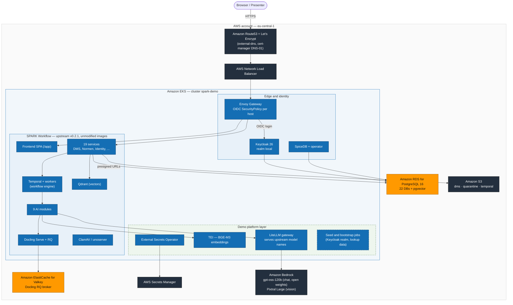

# SPARK Workflow on AWS EKS — Demo Deployment

Fully automated demo deployment of [SPARK Workflow](https://gitlab.opencode.de/bmds/planungs-und-genehmigungsbeschleunigung/spark-workflow) (EUPL-1.2) on Amazon EKS — open-source core, AWS managed services as the infrastructure foundation.

> **This is sample code, for non-production usage.** You should work with
> your security and legal teams to meet your organizational security,
> regulatory and compliance requirements before deployment. The
> [threat model](../docs/THREAT-MODEL.md) lists the demo-only risks this
> deployment accepts and the hardening required before any production use.

> Status: **Deployed & end-to-end verified** (2026-08-18/19): 72 app pods Running,
> Keycloak login via Envoy Gateway OIDC → SPA loads, `/api/identity/me` returns the
> demo user (verified JWT), chat via Bedrock `gpt-oss-120b` and embeddings via
> TEI `BGE-M3` respond through LiteLLM. Presenter runbook: [DEMO.md](DEMO.md).

## TL;DR — executive summary

The German government's open-source **SPARK Workflow** platform (document
management + AI-assisted permitting workflows) runs **unmodified** on AWS:
every application component stays open source inside one EKS cluster, and
AWS contributes exactly the commodity substrate — managed PostgreSQL,
object storage, cache, secrets, DNS/TLS and Bedrock as the LLM backend
(serving an open-weights model). One `make apply` builds the whole
environment from an empty account; one `make destroy` removes it. Login,
document upload, AI analysis pipeline and workflow orchestration are
verified end to end.

## Why this demo is built this way

1. **Digital sovereignty is the point of the upstream project** — so the
   demo never replaces an application component with a proprietary AWS
   service (no Cognito, no Neptune, no MQ drop-in). What you can run
   on-prem, you run here: Keycloak, Temporal, Qdrant, SpiceDB, Envoy,
   LiteLLM, TEI — all in-cluster, all swappable back.
2. **AWS as substrate, not lock-in**: where upstream says "any PostgreSQL /
   any S3-compatible store / any Redis works", the demo plugs in RDS,
   S3 and ElastiCache — managed operations for the parts that are
   commodity anyway, each behind upstream's own configuration contract.
3. **LLM without GPUs and without API keys**: LiteLLM serves the exact
   upstream model names and routes to Amazon Bedrock (`gpt-oss-120b`,
   open-weights) via pod identity — the 9 AI modules run without a single
   override or credential.
4. **Repeatability as proof**: the submodule is read-only; every adaptation
   is Terraform/Helm in this repo, every deviation documented with the
   observed failure that forced it. `destroy → apply` from zero has been
   verified hands-off.

## Architecture

Legend: 🟦 **blue** = open source in-cluster (solid border = ships with the
upstream project, dashed = added by this demo) · 🟧 **orange** = open-source
engine as AWS managed service · ⬛ **dark** = AWS-native managed substrate.
(Mermaid cannot load the official AWS architecture icons portably, so the
diagram follows the AWS color language instead.)



**Upstream vs. demo layer:** everything inside "SPARK Workflow" plus
Keycloak/SpiceDB/Envoy/Qdrant/LiteLLM/TEI is the upstream open-source
stack (deployed through the upstream umbrella chart with values overlays);
the dashed pieces (seed/bootstrap jobs) and the entire AWS substrate are
this demo's Terraform/Helm. The submodule itself is never modified — see
"Deviations" below for every overlay, with the observed reason.

### Component detail

| Component | Hosting | Service |
|---|---|---|
| SPARK Workflow (frontend, 15 backend pools of one modulith image, 9 AI modules + 3 data services) | EKS | Upstream Helm charts (`00-umbrella/spark-platform`, v0.3.0), images from `registry.opencode.de` (v0.3.0) |
| Workflow engine (Temporal) | EKS | Official Temporal chart (upstream wrapper), state in RDS |
| PostgreSQL + pgvector (11 databases) | **AWS Managed** | Amazon RDS for PostgreSQL; the application's databases are created by the upstream `db-init` chart, the platform layer's by our `db-roles` job |
| Object storage (documents, Temporal payloads, quarantine) | **AWS Managed** | Amazon S3 (S3-compatible interface, presigned URLs) |
| Redis (Docling RQ broker) | **AWS Managed** | Amazon ElastiCache for Valkey |
| Vector database (Qdrant) | EKS | Official qdrant chart 1.17.0 (upstream 0.3.0 treats Qdrant as an external endpoint) |
| Identity (Keycloak) + oauth2-proxy | EKS | Open-source in-cluster deployment, state in RDS |
| Authorization (SpiceDB) | EKS | Plain Deployment in the platform chart (no operator), state in RDS |
| Document processing (Docling Serve) | EKS | `docling-rq` chart vendored from upstream 0.2.3 (`helm/docling-rq`); CPU mode by default, GPU node group optional |
| Service-to-service identity (machine-identity proxy) | EKS | nginx in the app namespace that stamps the SPIFFE header the backend expects from a mesh sidecar (upstream: Istio) |
| LLM gateway (LiteLLM) | EKS | Serves the upstream model names, backend Amazon Bedrock (swappable) |
| API routing (Envoy Gateway) | EKS | CNCF Envoy Gateway behind an AWS NLB |
| Secrets | **AWS Managed** | AWS Secrets Manager, synchronized via External Secrets Operator |
| ClamAV, unoserver | EKS | Upstream charts |

## Deployment

- **Terraform** provisions the entire AWS infrastructure and the platform addons.
- **Helm** deploys the SPARK Workflow stack via the upstream umbrella charts with demo overrides from `helm/`.
- Upstream code lives unmodified in the submodule [`spark-workflow/`](spark-workflow/).
- Configuration comes entirely from the root `.env` (untracked, see `../.env.example`) — no account/zone IDs in Git.

```bash
# in the repo root: cp .env.example .env && set the values
#   IMPORTANT: set ACME_EMAIL to YOUR address — Let's Encrypt issues the
#   TLS certificate to it. With the placeholder the certificate is not
#   issued and the demo stays on plain HTTP (port 80) until you fix it.
make init      # terraform init (optional — apply/plan/destroy run it for you)
make plan      # preview
make apply     # terraform init + bring up the demo
make destroy   # full teardown
make validate  # fmt-check + terraform validate (no AWS access)
```

`make apply` runs `terraform init` itself, so a fresh checkout needs no
separate step. If the first `make apply` ever reports an uninitialised
backend, run `make init` once and retry.

### Users & roles

The demo follows the upstream identity model exactly (audited against
`docker/keycloak/bootstrap.sh` and the `authentification` shared lib):

- Roles are **Keycloak realm roles** `admin`, `user`, `service` — the backend
  derives the application role from the `realm_access.roles` JWT claim
  (precedence admin > user > service). Every human user needs `user` or
  `admin`, otherwise the frontend rejects the session.
- The bootstrap job (platform chart) creates the realm, the confidential
  client `local-client` (with the audience mapper and the realm-management
  `view-*` grants its service account needs for the app's user listing), and
  one demo user with realm roles `["admin", "user"]` — the same set the
  upstream local stack creates.
- **Adding users is done in Keycloak** (upstream has no in-app user
  management; it is a roadmap item there): Keycloak admin console →
  realm `local` → Users → Create user (set email + password, mark email
  verified) → Role mapping → assign realm role `user` (and `admin` if
  wanted). The app picks new users up automatically via its `/users`
  endpoint. Admin console URL and credentials: see [DEMO.md](DEMO.md) §1/§11.
- Lookup data (procedure types, statuses) is seeded by the backend itself at
  its first start from the catalog shipped in the image (0.3.0; the 0.2.x
  seed jobs are gone). Own catalogs go to `/seed/catalog` (upstream docs).

### LLM integration

- Chat/reasoning: **Amazon Bedrock** via the **LiteLLM** gateway intended by upstream, model **`gpt-oss-120b`** (open-weights, on-demand in `eu-central-1`). Access via EKS Pod Identity, region configurable via `BEDROCK_REGION` (default `eu-central-1`).
- Vision (VLM enhancement stage of the extraction pipeline): **Pixtral Large 2502** via the EU cross-region inference profile `eu.mistral.pixtral-large-2502-v1:0` — routing stays inside the EU geography. Weights are published (Mistral Research License, i.e. more restrictive than Apache-2.0); the only weights-available vision model in the EU profiles today. Configurable via `BEDROCK_VLM_MODEL_ID`.
- Embeddings: **BGE-M3** via an in-cluster **TEI** deployment (text-embeddings-inference, CPU) — exactly the upstream embedding model.
- Any other OpenAI-compatible backend remains possible via configuration.

## Deviations from the upstream defaults — what, where, why

The upstream code (submodule) is **unmodified**. All deviations live in
this repo: Terraform (`terraform/`), demo values overlay
(`helm/values/spark-workflow.demo.yaml.tftpl`), platform chart
(`helm/platform/`), cluster-config chart (`helm/cluster-config/`), the
vendored Docling chart (`helm/docling-rq/`) and a Helm postrenderer hook
(`helm/postrender-spark-workflow.sh`, a pass-through since 0.3.0). Every
deviation was verified during a live deploy from zero; "observed" = an error
that actually occurred and forced the change.

### A. AWS managed services instead of in-cluster operation

| Component | Upstream expectation | Demo on AWS | Why |
|---|---|---|---|
| PostgreSQL (+pgvector) | Cloud SQL / any PostgreSQL; databases via the upstream `db-init` chart, roles pre-existing | **Amazon RDS for PostgreSQL 16**, one instance, 11 databases: `application` (all 15 pools), `temporal`/`temporal_visibility`, `spicedb`, `keycloak`, `gesetze_normen`, `jura`, `gesetzesbegruendung`, `rechtsaenderungs_monitoring`, `rechtsbegriffe` | Explicitly supported by upstream. The **upstream `db-init` chart** (inside the spark-platform umbrella) creates the application's databases and pgvector extensions, reading the RDS admin credentials from the ESO ClusterSecretStore (`guard.namePattern: ""` keeps the upstream-local names); it creates no roles by design, so the platform chart's `db-roles` pre-install job creates the four roles and the three databases the platform layer opens before the umbrella exists (`keycloak`, `spicedb`, and `gesetze_normen` with the upstream laws seed — the seed dump carries psql-17 directives the chart's restore does not strip). Seed SQL is staged from the submodule to S3 by Terraform |
| Object storage | MinIO / S3-compatible (Rook/Ceph) | **Amazon S3** (4 buckets: dms, temporal-payloads, temporal-archival, quarantine) | The app speaks endpoint+keys incl. presigned URLs → S3 is the reference. CORS for browser uploads on the dms **and quarantine** buckets — with ClamAV enabled (default), presigned user uploads target the quarantine bucket first (observed: uploads failed in the browser until the quarantine bucket carried the CORS rule); access via a dedicated IAM user scoped to the buckets (the app expects static keys — documented demo deviation vs. short-lived credentials) |
| Redis (Docling RQ broker) | Redis container in the (0.2.3) docling-rq chart | **ElastiCache for Valkey** (TLS + AUTH, `rediss://`), always provisioned | The vendored chart takes the broker from the `docling-rq-redis-url` Secret (`redisUrl.secretName`); its embedded Redis subchart is not carried over |
| Secrets | External-Secrets-compatible service (e.g. Vault) | **AWS Secrets Manager** as the ESO backend | Exactly the ESO pattern required by upstream. Terraform generates ALL credentials and stores them in ASM; ExternalSecrets create the 13 Kubernetes Secrets the 0.3.0 charts reference (one `spark-backend-secrets` for all 15 pools via `envFrom`, one per data service, Temporal, LiteLLM, Docling; names from a full rendering — `.kiro/tools/render-workflow.sh` lists them) |
| LLM backend | Pharia AI / vLLM behind LiteLLM | **Bedrock `openai.gpt-oss-120b-1:0`** via LiteLLM (Pod Identity, `BEDROCK_REGION`, default `eu-central-1`) + **TEI** in-cluster for BGE-M3 | No GPU cluster needed; the model itself is open-weights. LiteLLM serves the models under **exactly the upstream names** `self-hosted/gpt-oss-120b` and `self-hosted/bge-m3` — so the AI modules keep their upstream model names. Since 0.3.0 the modules no longer call LiteLLM for chat themselves: every `self-hosted/*` name routes to the Temporal queue `llm-custom`, served by the `llm-client` worker with `LITELLM_BASE_URL`; the `llm-ionos` queue stays on for the EWMS extraction path whose OCR model name (`ionos/lightonocr-2-1b`) is a code constant — LiteLLM serves that name with the vision model too |
| VLM (vision) backend | `VLLM_MODEL=self-hosted/gpt-oss-120b` (upstream default) | **Bedrock Pixtral Large** via the EU profile `eu.mistral.pixtral-large-2502-v1:0`, served by LiteLLM as `self-hosted/pixtral-large`; overlay sets `VLLM_MODEL` to that name | gpt-oss-120b is text-only — the VLM stage sends image content blocks (observed: Bedrock 400 "This model doesn't support the image content block" on every element, `vlm-batch-processing` fails the document). Only weights-available vision model in the EU cross-region profiles; `BEDROCK_VLM_MODEL_ID` swaps it |
| DNS/TLS | "cert-manager optional", ingress external | **Route53** (external-dns, source `gateway-httproute`) + **Let's Encrypt DNS-01** (cert-manager, Route53 solver) | Fully automatic given the hosted zone ID from `.env`; DNS-01 avoids the chicken-and-egg problem with HTTP reachability |
| Kafka/MSK, Amazon MQ | — | **not used** | SPARK Workflow uses neither Kafka nor RabbitMQ |

### B. EKS-specific — it does not run without these adjustments

| Adjustment | Location | Why (observed) |
|---|---|---|
| Node SG: self-ingress **all ports** | `terraform/modules/eks` | The EKS module only opens ephemeral ports (≥1025) between nodes. The upstream services expose **pod port 80** → Envoy could not reach backends on other nodes (`503 upstream connect timeout` after successful login) |
| **100 GiB gp3 root volumes** | `terraform/modules/eks` | ~30 container images in the stack; the 20 GiB default volumes filled up → `disk-pressure` taints + pod evictions |
| **gp3 as the default StorageClass** (gp2 de-defaulted) | `terraform/modules/k8s-addons` | The EKS default gp2 is in-tree/legacy; charts with `storageClassName: ""` (ClamAV!) otherwise do not provision at all |
| **Qdrant node group pinned to ONE AZ** | `terraform/modules/eks` (`qdrant_subnet_index`) | Qdrant PVs are zonal EBS volumes. Multi-AZ node group: node replacement landed in a different AZ → PVs stranded (`didn't match PersistentVolume's node affinity`) |
| **4× m6i.2xlarge** default pool | `.env` `SPARK_WORKFLOW_NODE_COUNT=4` | 73 pods with upstream resource requests do not fit on 3 nodes (`Insufficient cpu/memory`) |
| **amd64 instances** (no Graviton) | `terraform/modules/eks` | Upstream only publishes amd64 images |
| NLB via **aws-load-balancer-controller** | `helm/cluster-config` (EnvoyProxy annotations) | The Envoy Gateway service gets an internet-facing NLB (ip targets) — the only public entry point |
| **EKS Pod Identity** instead of IRSA | `terraform/modules/k8s-addons` | Roles for EBS CSI, LB controller, ESO, cert-manager, external-dns, and LiteLLM→Bedrock (`bedrock:InvokeModel*`, scoped to foundation models) |

### C. Perimeter auth & API routing (Envoy Gateway)

| Adjustment | Why |
|---|---|
| **Envoy Gateway OIDC** (SecurityPolicy) instead of oauth2-proxy | Upstream names "Envoy + OIDC provider" as the target design; one auth point + native prefix rewrites in the gateway. oauth2-proxy remains as a fallback flag in the platform chart (`oauth2Proxy.enabled`) |
| OIDC **back-channel via `backendRefs`** to the Keycloak service | Token redeem/JWKS via the public hostname = hairpin through the internet-facing NLB → fails from the Envoy pods (observed: 503 right after login). The front-channel (browser redirects) stays public |
| **One SecurityPolicy per host** (frontend-oidc, temporal-oidc) instead of one policy for both routes | `redirectURL` must match the host where the flow starts: Envoy's oauth2 filter stores CSRF/session cookies on the originating host — if the callback lands on a different host, the cookies are missing (observed: "OAuth flow failed" after login on the Temporal UI). Each host also needs its own redirect URI in the Keycloak client (the bootstrap job registers both) |
| **26 API routes on the frontend host, paths unchanged** (two HTTPRoutes: 16 `/api/<module>/v1/` + `/api/identity/` + `/api/temporal/` rules, 10 `/api/v2/<module>/` rules; `/api/law-changes/v1` is the only rewrite) | The 0.3.0 contract is the upstream `gateway-routes` chart's dashboard-api route table: the SPA's single client calls `/api/...`, every spark-backend pool serves the whole `/api` surface and the pool only separates the load. The upstream chart itself is not installed (its OIDC back-channel targets the public Keycloak host on 443 — the NLB hairpin that fails from the Envoy pods — and it needs a second confidential client); its route table is reproduced in `helm/platform/values.yaml` (`apiRoutesV1/V2`). Prometheus endpoints under `/api/.../metrics` are blocked at the edge like upstream does |
| **`/app` prefix strip** as a separate HTTPRoute (`frontend-app`) | The frontend image templates `VITE_BASE_URL=/app` into index.html, but its nginx serves from the web root — the gateway must rewrite `/app/...` → `/...` (observed: page loads via the nginx SPA fallback but every `/app/assets/*` request 404s → blank page). Separate route because the frontend route already carries 16 rules (the Kubernetes maximum per HTTPRoute); Gateway API matches the longest prefix across routes of the same hostname |
| BackendRef **port 80** | All upstream service charts expose service port 80 (observed: `ResolvedRefs=False PortNotFound` degraded the entire route) |
| **`AUTH_MODE=strict`** (0.3.0 accepts `strict` or `disabled`; the 0.2.x dry-run mode is gone) | Every pool verifies the Bearer token Envoy forwards after the perimeter login (`forwardAccessToken`) and enforces SpiceDB permissions; `disabled` leaves `auth.user` null and `/api/identity/me` answers 401. The privileged Keycloak client of the identity module (`AUTH_PRIVILEGED_*`, all three or none) is the realm's own confidential client, as in the upstream local stack — upstream's example values set two of the three and every pool refuses to start |
| **Machine-identity proxy** for the agent modules' calls into the pools (`DMS_BASE_URL`, `TEMPORAL_JOB_SERVICE_URL` → `http://machine-identity-proxy.<app ns>`) and for every call into the three legal-data services (`LAW_DATABASE_*` of `modul-rechtsmethodik` and `LAW_DATABASE_BASE_URL` of the examination pool → `…/law/<service>/…`, prefix stripped) | In strict mode a service-to-service call is identified by the SPIFFE id in the `x-forwarded-client-cert` header that an Istio sidecar sets from the caller's mTLS certificate (`AUTH_ALLOWED_MACHINE_IDENTITIES`); the Python modules carry no credential of their own (observed from zero: every `dms_get_file_metadata` activity 401, the extraction workflow failed; after the first owner session every `MVPWorkflow` failed on `LoadNormWorkflow` 401 against the gesetze-normen service — the material completeness check showed "0 von 33 Normen geprüft" and no findings). The demo runs no mesh, so a small nginx in the app namespace stamps the header for exactly these hops. Trust boundary unchanged: without a mesh the pools accept that header from any pod in the cluster anyway (THREAT-MODEL R-1); production replaces the proxy with the mesh |
| Keycloak: realm `local`, client `local-client`, audience mapper, demo user | Bootstrap job in the platform chart, derived 1:1 from the upstream script `docker/keycloak/bootstrap.sh` (same names → no hidden couplings) |
| **One ConfigMap and one Secret for all 15 pools** (`global.backend.config` / `secretRefs`) with the complete required set, reference `process-compose.yaml` of the upstream repo | Every pool parses the env of EVERY feature at startup (`features.ts`): one required variable missing in any feature stops all 15 pools. Upstream's example values cover a fraction of the set; `ENV=production` requires `CLAMAV_ENABLED=true` plus the four `QUARANTINE_*` variables; `TEMPORAL_JOB_SERVICE_URL` is required by four agent modules and set by no 0.3.0 values file |
| **Keycloak admin surface denied at the gateway**: `/admin/master/**` + `/realms/master/**` → 403 via an `HTTPRouteFilter` `directResponse` on its own HTTPRoute (`keycloak-admin-denied`) | Upstream routes the whole Keycloak host with a single catch-all rule, so the `master` realm's admin console was reachable from the internet with only the bootstrap admin password in front of it (observed: a security scan of the live deployment cited `/realms/master/protocol/openid-connect/auth?client_id=security-admin-console`). Scope is deliberately **not** `/admin`: the console for every realm lives under `/admin/master/console`, while the token-protected admin REST API is `/admin/realms/<realm>` — and identity-management-service calls exactly that through the public hostname (`AUTH_BASE_URL`), so a blanket deny breaks `GET /users`. Verified after the change: console/master 403, `/admin/realms/local/users` 401 unauthenticated and 200 through the app, scripted OIDC login green. Admin access via `kubectl port-forward svc/keycloak 8080:8080` |
| **Source-IP allowlist on the public NLB**: `DEMO_ALLOWED_CIDRS` (root `.env`, comma-separated) → `loadBalancerSourceRanges` on the EnvoyProxy `envoyService` | A company or personal AWS account may not serve anything to unauthenticated callers, and a security scan counts the OIDC **login redirect** as exactly that — so route-level OIDC is not sufficient and the restriction has to sit at L4, where one value covers all three hostnames and both `:80`/`:443`. **Empty = open to the internet** (the from-zero default). Alternative for occasional demos: leave it open and `make destroy` afterwards |
| **Optional corporate identity provider**: `EXTERNAL_OIDC_ISSUER_URL`/`_CLIENT_ID`/`_CLIENT_SECRET` (root `.env`, any OIDC issuer) → the bootstrap job registers it as identity provider `corporate` in realm `local` (endpoints from the issuer's discovery document, roles `admin`+`user` via hardcoded-role mappers) and configures the realm's **Identity Provider Redirector** with it as default; the `keycloak-admin-denied` route additionally denies the realm's account console (`/realms/local/account`) | The apps keep trusting the demo realm (client, audience mapper, `identity-management-service` and its admin REST calls unchanged); only the authentication moves to the issuer, and the Keycloak login page never renders a password form — an anonymous visitor gets nothing but the redirect to the issuer. **Empty = off**: the demo user as before, which is the mode a customer or reviewer tests with. Values live in Secrets Manager (`…/auth/external-oidc`), nothing provider-specific in the repository. Redirect URI to register at the issuer: `https://<keycloak host>/realms/local/broker/corporate/endpoint`; the client must issue an `email` claim. Verified live 2026-10-20 (anonymous, cookie jar): `/app/` and the Temporal UI end at the issuer's sign-in, the account console answers 403, the realm admin REST API 401 (observed on the way: `kcadm create … import-config` prints the discovered endpoints only with `-o`, and the account console was the last anonymous 200 on the host) |

### D. Workarounds for upstream chart gaps (candidates for upstream issues)

| Problem (observed) | Workaround |
|---|---|
| 0.3.0 drops the spicedb, qdrant, docling and redis charts and expects an authzed **spicedb-operator** in the cluster (`environment-config` renders a `SpiceDBCluster` CR), an external Qdrant (`<qdrant-host>`) and an external Docling (`<docling-host>`) | SpiceDB as a plain Deployment in the platform chart (`ghcr.io/authzed/spicedb:v1.51.0`, the version the 0.2.x operator chart pinned; migrate init container; `environment-config.spicedb.enabled=false`); Qdrant from the official chart 1.17.0 on the dedicated node pool; Docling from the 0.2.3 `docling-rq` chart vendored into `helm/docling-rq` (EUPL-1.2, THIRD_PARTY_NOTICES) with ElastiCache Valkey as broker |
| `modul-rechtsmethodik` requires ten `LAW_DATABASE_*` URLs that the 0.3.0 chart no longer sets (`LAW_DATABASE Field required`, CrashLoop); `modul-inhaltsextraktion` requires `DMS_BASE_URL`, set by no 0.3.0 values file | Overlay sets both; the law-database URLs and DMS go through the machine-identity proxy (the legal-data services run `AUTH_MODE=strict` too and the module sends no credential) |
| The seeded law database (`gesetze_normen`, upstream dump) carries federal law only; the sample procedure's legal basis names four North-Rhine-Westphalian state laws (`LFoG NRW`, `LJG NRW`, `LPlG NRW`, `DSchG NRW`) | Their norm deconstruction fails with `No document found for jurabk` and the material check shows those norms without results (27 of 76 norm runs on the from-zero proof); the federal norms complete. Data gap of the seed, not of the deployment — a fuller dump or the state-law import is an upstream topic |
| `CHUNKING_MODEL` placeholder `<llm-model-name>` on the two data services suggests the chat model; the chunking client **embeds** at startup (observed: LiteLLM 500 "Unable to determine bedrock embedding provider for openai.gpt-oss-120b", CrashLoop) | `CHUNKING_MODEL=self-hosted/bge-m3`, the value the 0.2.3 charts carried |
| `llm-client` with `ENV` other than `dev` requires `QUEUE_NAME`, `QUEUE_MAX_CONCURRENT`, `QUEUE_MAX_PER_SECOND` (ValueError) and nothing sets them | Overlay: `llm-custom` 8/20 (`.env.local` values of upstream), `llm-ionos` 4/10 |
| Helm replaces lists: a custom `global.extraEnv` **displaces** upstream's `AUTH_*` block, and a leaf chart's own `env` wins over `global.extraEnv`, so every leaf placeholder (`<otel-collector-host>`, `<temporal-host>`, `<s3-region>`, `<qdrant-url>`, `<docling-host>`, `<litellm-api-url>`) survives unless that chart's `extraEnv` overrides it | The overlay re-lists the `AUTH_*` block and overrides every placeholder per chart; `.kiro/tools/render-workflow.sh` greps the render for `value: <...>` and the only acceptable count is 0 |
| `environment-config` renders NetworkPolicies that allow egress to 53/443 and 5432 into 10.0.0.0/8 only (Keycloak/LiteLLM/SpiceDB in the platform namespace, Valkey 6379, Bedrock unreachable) and an otel-collector with traces only (every pool warned `OTLP metric export failed … Unimplemented` every 10 s) | `networkPolicy.enabled=false` (demo trade-off, THREAT-MODEL R-2), `otel.pipelines.metrics=true` |
| `db-init` refuses every database name that does not start with `<stage>-` (`guard.namePattern`) and creates no roles | `guard.namePattern: ""` for the upstream-local names on a dedicated RDS instance; roles from the platform chart's `db-roles` job (section A) |
| Registry repository names differ from the 0.3.0 values (`frontend-app`, `anonymisierung-module`, `clamav-api`, … do not exist on `registry.opencode.de`; `fallvergleichsservice`, `norm-tbm-spec-module`, `landingpage`, `frontend-demo-app` have no repository at all) | Images pinned under the 0.2.x repository names with tag `v0.3.0` (`frontend`, `modul-*`, `*-db-service`, `llm-client`, `rechtsaenderungs-monitoring`, `spark-backend`); ClamAV from `ghcr.io/devhatro/clamav-api:v2.0.0` (the image the 0.2.3 chart named); `fallvergleichsservice`, `modul-normenermittlung`, `landingpage`, `prototype-demo` disabled |
| Default pool size: two replicas per pool (30 pods) | One replica per pool in the demo (`backend-services.<pool>.replicaCount: 1`) |
| The three worker pools exit at cold start when the Temporal namespace `default` does not exist yet (`Namespace default was not found`, exit 1) | Nothing to do: the namespace is created by the chart seconds later and Kubernetes restarts the pool (observed: 2–3 restarts of agent-orchestration, dms and project-logic within the first minute, then stable) |
| The upstream default `VLLM_MODEL`/`VLM_SUMMARY_MODEL_NAME` point the **vision** stages at models that are not on Bedrock | Overlay points both at `self-hosted/pixtral-large` (vision-capable, served by LiteLLM); everything else keeps upstream names |

### E. Behavior of the published v0.3.0 images

| Problem (observed) | Demo configuration |
|---|---|
| The v0.3.0 Python images run on a **shell-less minimal base**: an `exec` probe with `sh -c` errors "executable file not found", the pod reads 0/1 and is restarted every 10 min (observed from zero on all 11 worker deployments) | The worker probes run in the image's own `python -c` (same check: an established connection to the Temporal frontend, port 7233 = 0x1C41 in `/proc/1/net/tcp`) |
| `modul-inhaltsextraktion` bakes in `TRANSFORMERS_OFFLINE=1` but does **not** contain the expected model cache → the guard model load crashes | `TRANSFORMERS_OFFLINE=0`/`HF_HUB_OFFLINE=0` + `HF_HOME=/tmp/hf` (non-root without HOME: default cache `/.cache` not writable → `PermissionError`) |
| `INJECTION_MODEL_TOKEN` requires `min_length=1` but is a bearer token for an **external** guard service (not part of the demo) | Non-empty placeholder; `INJECTION_MODEL_URL` points to localhost (flow documented as limited) |
| The frontend image templates `VITE_*` into `/usr/share/nginx/html` at startup (`sed -i`) and binds port 80 → `Permission denied` with the chart's restricted defaults (uid 65532, read-only root FS); unchanged between v0.2.3 and v0.3.0 (Dockerfile has no `USER`, nginx listens on 80) | `podSecurity.restricted: false` + `podSecurityContext` override to root — **documented demo deviation** (the upstream fix would be `--chown` in the image build + port ≥1024) |
| TEI/BGE-M3: warmup allocates for the full `max-batch-tokens` (16384) → OOMKilled even with 16 Gi | `--max-batch-tokens=4096` + 16 Gi limit |
| Modules validate `OTEL_ENDPOINT` with `min_length=1` | The otel-collector of the upstream `environment-config` chart (`http://otel-collector.<ns>:4317`, debug exporter, metrics pipeline on) |
| The SPA ships client-side origin allowlists for presigned storage URLs (`VITE_ALLOWED_UPLOAD_ORIGINS`, `VITE_ALLOWED_DOWNLOAD_ORIGINS`) that default to empty | Both set to the regional S3 endpoint in the frontend values — with an empty allowlist the SPA blocks every upload/download client-side before any request is sent (observed: "Hochladen fehlgeschlagen" although presigned URL generation succeeded and S3 never saw a request) |
| Temporal workers (`modul-*`, `llm-client`) connect to the Temporal frontend **once** at startup; when the frontend is not up yet, the worker coroutine dies with `RuntimeError: Failed client connect … Connection refused`, but the process and its health server stay alive, so the pod reads `Running 1/1` while nothing polls its task queue (observed after `make apply` from zero: 16 of 16 module pods and 3 of 3 `llm-client` pods dead for 30 min, `temporal task-queue describe` listed zero pollers, every uploaded document stayed `Scheduled`; a `rollout restart` fixed each one). The charts expose no worker-health endpoint and no init-container hook | Overlay sets an `exec` startup probe (10 min window) and liveness probe (3 × 30 s) on the 10 worker deployments that test the one observable fact: an established connection to the frontend (`grep ':1C41 01' /proc/1/net/tcp`, 0x1C41 = 7233). Verified: all 19 pods start with 0 restarts; with the frontend scaled to 0 all 19 are restarted by the liveness probe within 2 min, and after it returns every pod reconnects via the startup probe within 10 min |
| The 15 spark-backend pools share one image and one ConfigMap; `/startup` turns green only after migrations, seeds and the SpiceDB schema write (300 s window, chart default) | Nothing to change; the worker pools' exits before the Temporal namespace exists are in section D |

#### Image tags (submodule at v0.3.0)

The submodule is pinned to the upstream release tag **v0.3.0** (2026-10-14).
Every image the demo runs carries that tag on the openCode registry under
the 0.2.x repository names (the 0.3.0 values files name repositories that
do not exist there, section D):

| Image tag | Images | Note |
|---|---|---|
| **v0.3.0** (16) | `spark-backend` (one image, 15 pools), `frontend`, `modul-anonymisierung`, `modul-bewertung`, `modul-einwendungsmanagement`, `modul-formale-pruefung`, `modul-inhaltsextraktion`, `modul-plausibilitaet-pruefung`, `modul-rechtsmethodik`, `modul-risikohinweiser`, `modul-suche-und-zuordnung`, `gesetze-normen-db-service`, `gesetzesbegruendung-db-service`, `jura-db-service`, `llm-client`, `rechtsaenderungs-monitoring` | The 0.2.3 PII-redaction fix (`modul-anonymisierung`, upstream issue #40) and the prompt-schema fix (`modul-formale-pruefung`) are in this deployment — THREAT-MODEL B-4 closed for the modules |
| other | `unoserver:3.5` (openCode), `ghcr.io/devhatro/clamav-api:v2.0.0`, `ghcr.io/authzed/spicedb:v1.51.0`, `qdrant/qdrant` (chart 1.17.0), `quay.io/docling-project/docling-serve-cpu:v1.14.3`, `temporalio/*:1.31.2`, `otel/opentelemetry-collector-contrib:0.145.0`, `public.ecr.aws/nginx/nginx-unprivileged:1.29-alpine` | Pinned in the overlay, the platform chart and the app-workflow module |
| none | `fallvergleichsservice`, `modul-normenermittlung`, `landingpage`, `prototype-demo` | No published image (disabled, section D) |

Verified statically (`.kiro/tools/render-workflow.sh`: 113 resources, 0
upstream placeholders left in any env value, 30 × v0.3.0 image references)
and **verified live from zero** on 2026-10-20 (destroy → `make apply` on an
empty account, 195 resources, 26 min, one attempt): `scripts/verify.sh` 6/6
(64 pods Ready, 15 pools, Temporal pollers on seven task queues, both
SecurityPolicies accepted), login through the Keycloak form with a cookie jar
(the Identity Provider Redirector of the optional corporate SSO bypassed with
`kc_idp_hint`, the path a customer without SSO takes), project created,
`demo-data/*.zip` uploaded through the SPA's presigned-URL sequence,
`FileProcessingWorkflow` → `process-documents-workflow` → `FVPWorkflow`: 54 of
54 Temporal workflows completed, both documents assigned by the formal
completeness check (confidence 0.99 and 0.95, 0 unassigned), 56
`openai.gpt-oss-120b-1:0` and 17 `eu.mistral.pixtral-large-2502-v1:0`
Bedrock invocations in `eu-central-1` for one two-document ZIP.

A second from-zero cycle on 2026-10-21 00:00 UTC (after the three fixes of
the evening: cookie drop, law-database routing, findings workflow) ran the
same path again on the first attempt — 195 resources, `verify.sh` 7/7,
formal check 0.99/0.96 — and then the material completeness check: the norm
deconstruction (`BatchMVPWorkflow`) completed for every norm whose law the
seeded database carries, and one findings run (`suche_zuordnung_norm`, 31
Satz nodes, started as the norm card does) completed with 53 Fundstellen in
the project.

### F. Data protection and hardening defaults (deployment layer)

Added after a static review (checkov + semgrep over this repo's Terraform,
Helm and scripts) and a review of the deployment tree. Everything here is
in this repo's layer; none of it changes what the upstream charts deploy.

| Control | Location | Why / what it changes |
|---|---|---|
| **One customer-managed KMS key per environment** (`alias/<prefix>`, rotation on, 7-day deletion window) encrypts Secrets Manager entries, all S3 buckets (SSE-KMS + Bucket Keys), ElastiCache at rest, RDS Performance Insights and the exported RDS log groups | `terraform/modules/kms`, wired in `envs/demo/main.tf` | Key usage becomes auditable per principal in CloudTrail and revocable centrally. The ESO pod identity gets `kms:Decrypt` on exactly this key (`external_secrets_kms_key_arns`) — without it the module grants Decrypt on every key in the account. The S3 IAM user holds the matching `kms:GenerateDataKey*`/`Decrypt` so presigned browser uploads keep working |
| **S3 versioning + lifecycle** on every bucket (noncurrent versions expire after 7 days, abandoned multipart uploads after 7 days) | `terraform/modules/s3` | Overwrites and deletes stay recoverable for a demo day without the buckets growing without bound |
| **RDS**: CloudWatch log exports (`postgresql`, `upgrade`) into pre-created, KMS-encrypted log groups with 365-day retention, Performance Insights (free tier, KMS), Enhanced Monitoring (60 s), IAM database authentication (additive, services keep their passwords), `copy_tags_to_snapshot`, `deletion_protection` as a variable (`SPARK_WORKFLOW_RDS_DELETION_PROTECTION`, default false for the hands-off destroy) | `terraform/modules/rds-postgres` | Pre-creating the log groups keeps retention and encryption under Terraform; RDS would otherwise create never-expiring unmanaged groups on first export |
| **EKS public API endpoint fenced by `DEMO_ALLOWED_CIDRS`** (same list as the NLB; empty = open) | `terraform/modules/eks` (`cluster_endpoint_public_access_cidrs`) | One allowlist for both internet-facing surfaces. Include the address you run terraform/kubectl from, or the apply locks itself out |
| **Terraform registry modules pinned to the commit a release tag points at** (vpc v5.21.0, eks v20.37.2, eks-pod-identity v1.12.1) | `terraform/modules/{network,eks,k8s-addons}` | A `~>` range resolves to whatever the registry serves tomorrow; a commit hash does not |
| **Availability zones pinned by name** (`<region>a..c`), with a postcondition on the count | `terraform/modules/network` | A sorted-and-sliced zone list shifts the subnet layout when AWS adds a zone to the region; `availability_zone_names` overrides for regions with non-contiguous letters |
| **TEI model revision pinned** (`--revision=<commit>` of `BAAI/bge-m3`) | `helm/platform/values.yaml` (`tei.revision`) | The model is downloaded at pod start; a floating `main` would silently change what the demo embeds with |
| Static-analysis suppressions carry their reason inline (`#checkov:skip=…` / `# nosemgrep: …`) | Terraform + Helm files | Every remaining finding is a deliberate demo trade-off (single-AZ RDS/Valkey, no secret rotation, no bucket access logging/replication, static S3 keys, demo-grade teardown flags) and says so where it applies; the production checklist lives in `../docs/THREAT-MODEL.md` |

### G. Operational notes (AWS-specific)

- **EKS provider tokens expire after 15 min.** Long applies (node rollouts, Helm upgrade across ~20 deployments) can abort with `Unauthorized` → renew the AWS session and **repeat the same command**; all steps are idempotent.
- **Increasing `node_count` afterwards:** The EKS module ignores `desired_size` changes (autoscaler convention). Run `aws eks update-nodegroup-config ... --scaling-config` once to catch up, then `make apply`.
- **Teardown:** `make destroy` — buckets have `force_destroy`, secrets `recovery_window=0`, the KMS key a 7-day deletion window. The complete destroy → apply cycle was run hands-off twice on 2026-10-20 (destroy 197 of 197 and 195 of 195 resources, apply 195 resources in 25 min each).
- **Applying this hardening to an environment created before it:** the KMS key, versioning, lifecycle, log groups and monitoring role are additive. Two changes replace resources: ElastiCache gets `kms_key_id` (replication group re-created, the RQ broker is stateless) and the Secrets Manager entries change their encryption key in place. Expect one RDS modification for the log exports/monitoring (`apply_immediately`).

## Directory layout

```
spark-workflow-demo/
├── spark-workflow/    # Upstream (git submodule, EUPL-1.2) — do not modify
├── terraform/         # IaC: VPC, EKS, RDS, S3, ElastiCache, Secrets, Addons
├── helm/              # Demo overlay (values/), platform chart, cluster-config, vendored docling-rq
├── scripts/           # verify.sh (deployment verification)
├── docs/              # Architecture and operations docs for the demo
├── CHANGELOG.md
├── LICENSE            # MIT-0 (demo code only)
└── THIRD_PARTY_NOTICES.md
```

## License

Demo code: MIT-0. Upstream submodule: EUPL-1.2 (unmodified). See [LICENSE](LICENSE) and [THIRD_PARTY_NOTICES.md](THIRD_PARTY_NOTICES.md).
